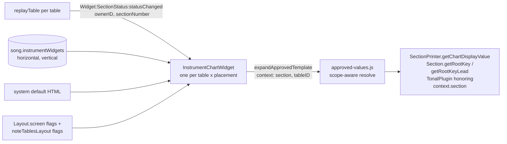

# Sprint 153 (instrument-chart-widgets), Iteration 1: high-level analysis

date: 20261103

Requested by [153-design.md](153-design.md), section "Iteration 1".  Sprint overview: [sprint-153.md](sprint-153.md).  Companion analysis: [154-it1-analysis.md](../154-print-layout/154-it1-analysis.md).

No code under `./` was changed for this analysis.  Statements about the code were read from the files linked below.

## 1. Verdict

Feasible, with one structural problem that drives the whole design: **every `${...}` variable and every chart placeholder today resolves against the *current* Section, not against the Section an Instrument is showing.**  An Observer showing Section 3 while the Main shows Section 6 would print Section 6's chord in both widgets.  Widgets that "follow the Instrument" therefore need a *scoped* expansion (Section + table), which does not exist yet.

Everything else is a repeat of patterns we already have:

- A per-Instrument, template-based widget with a Builder, a registry by `ownerID`, and EventBus updates: [SectionStatus](../../widget-design-SectionStatus.md).
- A song-level, user-editable, sanitized HTML template with `${...}` expansion and an editor: SongWidgets.
- Per-screen master toggles in `Layout`, plus per-table toggles in `noteTablesLayout`.

Recommendation in one sentence: build one new widget class (`InstrumentChartWidget`) with two layouts, fed by a scope-aware `expandApprovedTemplate(template, {section, tableID})`, driven by the existing `Widget:SectionStatus:statusChanged` event (no new event needed), configured by a song-level pair of templates that default to system HTML, and toggled by one new master flag per screen plus two new per-table flags.

## 2. Current behavior (what exists today)

| Concern | Where | Behavior |
|---|---|---|
| Song Widgets (song-level row) | [infinite-neck.js `updateSectionsStatus`](../../../../infinite-neck.js#L980) | Sanitizes the template, then `expandApprovedTemplate()`, then fills `#lblSongWidgets`; afterwards fills every `.lblSectionChartChord` / `.lblSectionMode` **by class, with the current Section's values** |
| Variable registry | [approved-values.js](../../../../approved-values.js#L83) `approvedValueEntries` | `resolve: () => ...` takes no arguments; providers are installed once in [`installModuleProviders`](../../../../infinite-neck.js#L295) and are hard-wired to `getCurrentSection()` |
| Expansion | [approved-values.js `expandApprovedTemplate`](../../../../approved-values.js#L407) | Regex over `${name}`; options only has `preserveUnknown`; unknown names stay literal |
| Existing chart/key variables | approved-values.js | `chartChordCaption`, `chartModeCaption` (placeholder ``s filled later by class), `rootKey`, `rootKeyLead` ([Section.getRootKey()](../../../../Section.js#L82)), `currentSectionCardinal`, `getSectionCaption`, the tonal note/function tokens (`transposedChordNotes*`, `enharmonicChartModeNotes`...) |
| Plugin tokens | [TonalPlugin.getApprovedCaptionValue](../../../../plugins/tonal/TonalPlugin.js#L590) | Receives `{song, section}` in `context` but its builders call `this.getCurrentSection(song)` and ignore it |
| Chart display formatting | [SectionPrinter.getChartDisplayValue](../../../../section-printer.js) | Already takes a `{section}` option, so it can format any Section's chord/mode, honoring `stripTonalRoots` and `addTransposedRootToChord` |
| Observer section resolution | [NoteTableController.js](../../../../NoteTableController.js#L1133) `getReplayOptionsArray`, `replayTable` | Each table gets `sectionIndex` (Observer: from `relativeSection`; Main/Listener: current), then emits `Widget:SectionStatus:statusChanged` with `ownerID` = table ID, `sectionNumber`, `rootKey`, `rootKeyLead` |
| SectionStatus widget | [templates/SectionStatus/](../../../../templates/SectionStatus/section-status.html) | Vertical (left rail) and horizontal (caption row) templates; already shows section number, relative section, loop light, record dot, root key, lead key |
| Left Rail DOM | [TableBuilder.js](../../../../TableBuilder.js#L246) | `td.tdLeftRailStack > div.leftRailStack (flex) > [.leftRailCaptionHost, .leftRailSectionStatusHost]` |
| Caption row DOM | [TableBuilder.js `buildCaptionRow`](../../../../TableBuilder.js#L276) | `div.captionRow` is the first child of `.instrumentBackground`; holds the `C`, `S`, `⇋`, `≡`, `T`, `N`, `W`... buttons |
| Master toggles | [layout.js](../../../../layout.js#L101) | `Layout.screen.{InstrumentCaptions, LeftRails, CaptionLooperLayout...}` per screen (`fullscreen`, `escaped`); `toggleInstrumentCaptions()` toggles `.captionRow` for **all** Instruments; `toggleCaptionLooperLayout()` sets `flex-direction` on **all** `.leftRailStack` |
| Per-table toggles | [infinite-neck.js `setUIFromNoteTablesLayoutOptions`](../../../../infinite-neck.js#L3827) | `noteTablesLayout[]` entries hold `SectionStatusLeft`, `CaptionLeft`, `TopToolCaption`; absent means `false` |
| Sanitizer | [html-sanitizer.js](../../../../html-sanitizer.js#L47) | Tag allow-list, **all attributes dropped except `class` (whitelisted) and a vetted `href`**; whitelist classes are mirrored in [html-whitelist.css](../../../../html-whitelist.css) |
| Song persistence | [SongPersistence.js](../../../../SongPersistence.js#L189) `persistSongWidgets` | Stored as `{lines:[...]}`, omitted when empty; validated by [bin/song-file-schema.js](../../../../bin/song-file-schema.js) |
| `/vdv` | approved-values.js (`/vdv` help block) | Lists every variable with a live sample from the current Section |

## 3. Findings that shape the design

### 3.1 Scope: variables are global, widgets must be per-Instrument

`resolve()` takes no context, and the placeholders `${chartChordCaption}` / `${chartModeCaption}` are filled *after* expansion by `$(".lblSectionChartChord")`, which would stamp the same value into every Instrument's widget.  For the widgets we want values resolved **at expansion time from a given Section**, not by class afterwards.

Cheapest fit: `expandApprovedTemplate(text, {context: {section, sectionIndex, tableID}})`, passed through `resolveApprovedValue` to `entry.resolve(context)`.  Entries that do not use the context are untouched; entries that matter for widgets use `context?.section ?? getCurrentSection()`.  The default keeps every existing caller and every Jest test as is.

### 3.2 The data is already there; the event is already there

`replayTable()` already computes the correct Section for every table and already emits a per-table event.  The widget only needs `ownerID` and `sectionNumber` from `Widget:SectionStatus:statusChanged`, then looks the Section up itself.  **No change to the event payload is required**, which keeps NoteTableController out of this sprint.

Open to verify: whether *every* path that changes chart data for a non-current Section (ChartInput edits, Fill from chart, paste, transposition) triggers a `replay()`.  If any path does not, the widgets would be stale until the next navigation.  The safe version is to also subscribe to whatever event the chart editors raise, or to add one `Widget:InstrumentChart:refresh` message.

### 3.3 SectionStatus already shows Key and Lead Key

The vertical SectionStatus has rows `SectionStatus_rootKey` and `SectionStatus_rootKeyLead`.  If the new vertical widget also shows Key and LeadKey, the Left Rail will show them twice.  See Hole H2.

### 3.4 Sanitize-then-expand gives us a clean trust boundary

The template is sanitized (only whitelisted classes survive, no attributes, no `style`), and *then* variables are expanded.  Variable output is trusted system HTML and is allowed to contain system classes that are not whitelisted (that is how `lblSectionChartChord` works today).  Consequences:

- User-authored layout is limited to the whitelist (rows, spacing, justification, font sizes).  For richer styling, the *variables* should emit styled spans (for example a chord token that already carries the class `icwChord`), not the user.
- System default HTML is trusted code, so it does not have to pass the sanitizer; but the requirement "default HTML that uses allowed/sanitized CSS classes" is worth keeping as a **test**: run the defaults through `sanitizeHtmlFragment()` and assert they are unchanged.  Then a User who clicks "Edit" starts from a template that survives save.
- Any new variable that echoes free text (chart chord and mode are strings; so are Section captions) must be HTML-escaped unless it declares `sampleFormat: 'html'`.

### 3.5 Per-table flags default to false, and that is fine

Absent `SectionStatusLeft` means hidden.  New flags follow the same rule; we do not support older files, so no migration is needed.

### 3.6 Naming slip in the wishlist

The last bullet says "`/vdd` variables".  `/vdd` is the Display Options Diff report (Sprint 148); the variable reference is `/vdv`.  This analysis assumes `/vdv`.

## 4. Recommended design

### 4.1 Pieces

### 4.2 The widget pair

One class, two placements, mirroring `SectionStatusBuilder`:

- `InstrumentChartWidget(destEl, ownerID, placementID, layout)` with `placementID` in `{ 'topRow', 'leftRail' }` and `layout` in `{ 'horizontal', 'vertical' }`.
- `InstrumentChartBuilder.createWidget(...)`, `registry` by `ownerID`, `removeByOwnerID()`, `removeAll()` (called wherever SectionStatus widgets are torn down on song load).
- `render()` builds the (sanitized, expanded) HTML into the host; `handleStatusChanged(data)` re-expands only when `sectionNumber` (or the template, or a chart revision) changed.
- Hosts are created in `TableBuilder`: the top row as a new sibling **above** `.captionRow`; the left rail as a third child of `.leftRailStack`.

Placement of the horizontal widget "in a row above the Instrument Caption Row, toggled separately" is therefore a new `div.instrumentChartRow` inside `.instrumentBackground`, outside `.captionRow`, so `toggleInstrumentCaptions()` (which hides `.captionRow`) does not hide it.  That also matches the print use case, where `InstrumentCaptions` is off but the chart row is on.

### 4.3 Templates, defaults and the editor

- Two song-level templates, `instrumentWidgets: { horizontal, vertical }`, stored only when they differ from the system default (the SongWidgets rule "omit when empty" becomes "omit when default").  One template pair per Song, not per Instrument: every Observer shows the same widget, which removes the repetition the 154 design is worried about.
- System defaults live in a pure module (`instrument-chart-defaults.js`) as two template strings plus a version; a song with no override automatically picks up improved defaults later.  A song with an override is frozen on purpose.
- Editor: clone of `SongWidgetsBuilder` (textarea, whitelist-class select, Save on blur/change, sanitized) plus **Reset to default**, a **layout selector** (horizontal / vertical), and a **live preview** that expands against the current Section.  It belongs next to the SongWidgets tab (`#divSongWidgetsTab`).
- New `getSanitizedInstrumentWidgets()` can simply alias `getSanitizedInfo()` like `getSanitizedSongWidgets()` does.
- New whitelist classes (names to decide, for example `icwRow`, `icwStack`, `icwSep`) go in both `WHITELIST_CLASSES` and `html-whitelist.css`.  Prefer **few** classes: the system variables carry the chord/mode/key styling.

### 4.4 Variables (`/vdv`)

Existing and sufficient as they are once they become scope-aware: `rootKey`, `rootKeyLead`, `currentSectionCardinal`, `getSectionCaption`, `transposedChordNotes*`, `enharmonicChartModeNotes`.

Needed (names are proposals):

| Token | Meaning | Note |
|---|---|---|
| `chartChord` | Display-formatted chord text for the scoped Section | **Text, not a placeholder span**; uses `SectionPrinter.getChartDisplayValue(..., {section})`; escaped |
| `chartMode` | Display-formatted mode text | same |
| `chartChordRaw`, `chartModeRaw` | Stored strings (for example `Cm7`, `C dorian`) | only if a use case appears; skip otherwise |
| `rootKey`, `rootKeyLead` | Key and Lead Key after transposition | already Section display names; confirm that the transposition plugin rewrites `rootID` per Section, which sprint 147 text implies |
| `rootKeyLeadIfDifferent` | Lead Key, or empty when it equals the Key | the app already has `.spanLeadDifferentFromRoot`; `rootIDLead == -1` falls back to the root, so "not set" is already a case |
| `instrumentCaption` | The table's caption (`options.baseID`) | helps print |
| `relativeSectionLabel`, `sectionCardinal` (scoped) | Section label of the Instrument, not of the song cursor | optional; overlaps SectionStatus |

Keep `chartChordCaption` / `chartModeCaption` exactly as they are for SongWidgets, and document in `/vdv` which tokens are **instrument-scoped**.  Add a flag to each entry (`scope: 'song' | 'section'`) so that:

1. `/vdv` can show a "Per-Instrument" column;
2. the widget expansion can choose to blank (not preserve) tokens that are `song`-scoped, such as BPM or plugin status lines, because showing the *current* BPM next to an Observer's Section is misleading.

The Tonal plugin tokens need their builders to honor `context.section` instead of `getCurrentSection(song)`; small and mechanical, but it touches a plugin, so call it out in the iteration plan.

### 4.5 Toggles and persistence

Follow the existing master/per-table split so the user gets both "all Instruments" and "this Instrument":

| Scope | New member | Pattern copied from |
|---|---|---|
| Per screen (`fullscreen`, `escaped`) | `Layout.screen.ChartWidgetRow` (top row master) and `Layout.screen.ChartWidgetLeft` (left rail master) | `InstrumentCaptions`, `LeftRails` |
| Per table | `noteTablesLayout[].ChartWidgetRow`, `noteTablesLayout[].ChartWidgetLeft` | `SectionStatusLeft`, `CaptionLeft` |
| Methods | `Layout.toggleChartWidgetRow(visible)`, `toggleChartWidgetLeft(visible)`; apply in `doToggles()`; `setUIFromNoteTablesLayoutOptions()` | `toggleInstrumentCaptions`, `toggleLeftRails` |
| Buttons | one button per Instrument for the top row, one for the left rail (see H5) | `C`, `S` |

Effective visibility is `master && perTable`.  Because 154 generates many Observers, it is worth deciding now that **an Observer with no `noteTablesLayout` flag inherits the flag of the table it listens to** (one helper, for example `getEffectiveNoteTableLayout(tableID)`).  Then `superchart.json` would not need `SectionStatusLeft: true` repeated six times.  This is the answer proposed to 154's open question about "needless repetition"; see that document.

### 4.6 Left Rail integration

The rail is a flex container whose direction is switched globally by the `⇋` button.  Adding the chart widget as a third child means three flex items stacked (`column`) or three side by side (`row`).  Recommendations:

- Keep the order: caption, section status, chart widget.  In `row` mode, three columns on a narrow floated Observer is too wide; allow the vertical widget to `flex-wrap` its content and to shrink (`min-width: 0`).
- Make the vertical default HTML short lines (chord, mode, key) with `overflow-wrap: anywhere`, because chord names like `F#m7b5/C` do not wrap.
- Test in `row` and `column` with the narrowest Observer in `superchart.json` (about 40% x 30% of the viewport).

### 4.7 Tool tables

`buildCaptionRow()` has a separate branch for `options.Tool` tables, with its own caption layout.  Recommend **excluding Tool tables** from this sprint (they are note sources, not Section viewers) and saying so in the help.  Decide in H6.

### 4.8 Performance

A re-expansion per table per replay is cheap, but replays are frequent and Observers can number in the dozens.  Memoize on `(sectionNumber, templateVersion, chartRevision)` inside the widget, and use the existing `markNoteTableTiming` / `measureNoteTableTiming` marks in `NoteTableController` to confirm no regression; see [repo timing notes](../903-timing-caching/).

## 5. New modules and broad-stroke members

| Item | New / changed | Purpose |
|---|---|---|
| `templates/InstrumentChart/instrument-chart.html` | new | `<template>`s for vertical and horizontal host markup (same pattern as `section-status.html`) |
| `templates/InstrumentChart/instrument-chart.css` | new | host and system-default styling (`icw*` classes) |
| `templates/InstrumentChart/instrument-chart.builder.js` | new | `InstrumentChartBuilder` (registry, `createWidget`, `removeByOwnerID`, `removeAll`), `InstrumentChartWidget` (`render`, `handleStatusChanged`, `setTemplate`, `destroy`) |
| `templates/InstrumentChart/instrument-chart-defaults.js` | new, pure | default horizontal/vertical HTML, `DEFAULTS_VERSION`, `isDefault(html)`; Jest-friendly (no DOM) |
| `templates/instrumentwidgets/` (editor html + builder) | new | clone of `songwidgets` editor with Reset, layout selector, preview |
| [approved-values.js](../../../../approved-values.js) | changed | `expandApprovedTemplate(text, {context})`, `resolve(context)`, per-entry `scope`, new tokens, `/vdv` column |
| [plugins/tonal/TonalPlugin.js](../../../../plugins/tonal/TonalPlugin.js) | changed | honor `context.section` |
| [TableBuilder.js](../../../../TableBuilder.js) | changed | create the top-row host and the left-rail host |
| [layout.js](../../../../layout.js) | changed | two screen flags, two toggles, `doToggles()` |
| [infinite-neck.js](../../../../infinite-neck.js) | changed | per-table toggle handlers, `setUIFromNoteTablesLayoutOptions()`, button binding, tear-down on song load |
| [html-sanitizer.js](../../../../html-sanitizer.js), [html-whitelist.css](../../../../html-whitelist.css) | changed | new whitelist classes, `getSanitizedInstrumentWidgets()` |
| [SongPersistence.js](../../../../SongPersistence.js), [bin/song-file-schema.js](../../../../bin/song-file-schema.js) | changed | `instrumentWidgets`, `noteTablesLayout` flags, `layout.screenList.*` flags |
| `_tests/jest/` | new | defaults survive the sanitizer, scoped expansion, effective-flag helper, schema round trip; per repo convention, no JSDom |
| [help.html](../../../../help.html) | changed | document the widgets and the `/vdv` scope column |

## 6. Holes and open decisions

| # | Hole | Options / recommendation |
|---|---|---|
| H1 | Scoped expansion does not exist (3.1) | Add `context` to `expandApprovedTemplate` and `resolve`; default stays "current Section".  Must land first; both sprints depend on it |
| H2 | Key / Lead Key shown twice in the Left Rail (SectionStatus vs the new vertical widget) | (a) Chart widget owns Key; SectionStatus rows hidden when the chart widget is on. (b) Chart widget default omits Key when SectionStatus is visible. (c) Accept duplication.  Prefer (a) for print; (b) is the smaller change |
| H3 | Stale widgets when chart data changes for a non-current Section | Verify which edit paths call `replay()`; otherwise add a refresh message |
| H4 | `rootIDLead` of `-1` / equal to Key | Hide Lead Key when not meaningful (`rootKeyLeadIfDifferent`) |
| H5 | Caption row is already crowded with buttons | Options: one `K` (chart) button with a small menu (top row / left rail / both); two buttons; or no per-Instrument button and use only the master toggle plus the Layout menu.  Decide with a UI sketch |
| H6 | Tool tables | Exclude for now and document |
| H7 | Free-text escaping in new tokens | Escape unless `sampleFormat: 'html'`; add a Jest test with `<b>` in a chord |
| H8 | Template per Song vs per Instrument | Per Song (recommended; keeps 154 simple).  Revisit only if users want different widgets per Instrument |
| H9 | Whitelist growth | Keep `icw*` classes minimal; styling rides on variables |
| H10 | Print legibility | The widget must scale with the Instrument (`em`, not `px`) because 154 scales tiles; add a print-friendly default (black on white, no ink-heavy fills) |
| H11 | Interaction with Sprint 147 "chord caption widget" | 147 expands tokens in the Section caption and SongWidgets; those remain as they are.  The caption row's `CaptionRowTonal` picker already shows chord/scale per table for SELF replays; this widget is read-only and compact, so do not merge, but say so in the help to avoid confusion |
| H12 | Persistence cost for the default rule | "Omit when equal to default" needs a normalizing compare (trim, line endings).  Use `isDefault()` on the persisted string |

## 7. Wishlist traceability

| Wishlist item | Covered by |
|---|---|
| Pair of widgets, vertical and horizontal, showing chord, mode and keys | 4.2, 4.4 |
| Optional horizontal row above the caption row, toggled separately from the caption row | 4.2, 4.5 (new `ChartWidgetRow` flags; row is a sibling of `.captionRow`) |
| Optional vertical widget in the Left Rail | 4.2, 4.6 |
| Plays in the `C` / `S` / `⇋` stacked or side-by-side scheme | 4.6 (third flex child; honors `CaptionLooperLayout`) |
| Editor, customizable like SongWidgets, system default HTML, allowed classes and `/vdv` variables | 4.3, 4.4, 3.4 |
| Chart Chord, Chart Mode, Key, LeadKey and flavors in `/vdv` | 4.4 (named `/vdd` in the wishlist; see 3.6) |

## 8. Suggested next steps

Order matters because 154 depends on the first two:

1. **Iteration 2, spike on scoped expansion.**  Add `context` to `expandApprovedTemplate` and `resolve`, scope `rootKey`, `rootKeyLead`, `chartChord`, `chartMode`, `currentSectionCardinal`; Jest the pure parts.  No UI.
2. **Iteration 3, widget with fixed defaults.**  `InstrumentChartWidget`, host creation in `TableBuilder`, layout flags and per-table flags, no editor yet; verify on `songs/demo/superchart.json` (Observers must show their own Sections).
3. **Iteration 4, editor and persistence.**  Song-level templates, Reset, preview, sanitizer classes, schema, help.
4. **Decisions needed before iteration 3:** H2 (Key duplication), H5 (button), H6 (Tool tables), and the effective-flag inheritance rule in 4.5, which 154 also needs.
