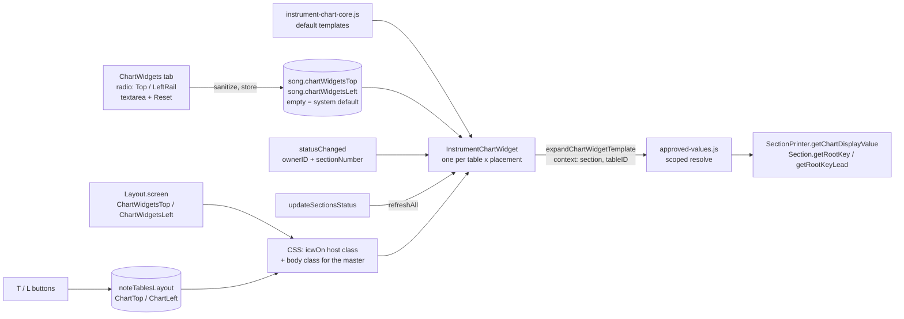

# sprint-153 Iteration 2: first-draft implementation plan

Design: [153-design.md](153-design.md) (Iteration 2 section)  
Sprint: [sprint-153.md](sprint-153.md)  
Analysis: [153-it1-analysis.md](153-it1-analysis.md)  
Next sprint (depends on this one): [154-it2-implementation-plan.md](../154-print-layout/154-it2-implementation-plan.md)

Status: **plan only, no code written.**  Per [sprints.md](../../../lifecycle/sprints.md) the files marked **CORE** below need `CORE-APPROVED`.  Because the plan covers a lot of ground, it ends with questions (section 8) for one more review round before coding starts.

---

## 1. Decisions carried in from Iteration 2

| Topic | Decision | Effect on this plan |
|---|---|---|
| `/vdd` vs `/vdv` | `/vdv` | Variable reference is `/vdv` |
| Editor GUI | One Tab page, **two radio buttons** (Top Chart, LeftRail Chart).  No lists of widgets, no CRUD.  Per Song, the User keeps the built-in default or modifies either or both | One textarea, bound to the selected radio; **Reset to default** per radio |
| Buttons | `T` = Top Chart Widgets, `L` = LeftRail Chart Widgets.  Inside the caption-row hamburger, to the right of `S` | Two new buttons in [TableBuilder.js](../../../../TableBuilder.js) `buildCaptionRow()` |
| Where buttons live | On the Main, "copied" onto Observers.  Observer buttons work individually for now.  The 154 panel sets up cloned state | Per-table flags only; **no inheritance in 153** (see Q1) |
| Template location | One place: the ChartWidgets tab (tied to the Main first) | Song-level templates, not per Instrument |
| H1 | Scoped expansion lands first | Step 1 |
| H2 | Accept duplication of Key / Lead Key in the Left Rail; author can switch off before printing | No change to `SectionStatus` |
| H4 | Accepted: the Caption row is already crowded, so use the existing hamburger | Step 4 |
| H6 | No Tool tables | No hosts, no buttons for `options.Tool` tables |
| 4.5 effective flag | Accept the recommendation: minimize repetition, use inheritance | **Open: it conflicts with persisting an explicit "off"** (Q1) |
| 154 notes | Allow Caption in the horizontal widget; default markup contains all the expansions, and authors delete what they do not want; show/hide/toggle siblings (`/vhw?`, `/vsw?`, `/vtw?`) for Layout elements | Default templates (Step 2), master flags and commands (Step 5) |

---

## 2. What exists today (verified in code) and what it changes

| # | Finding | Where | Consequence |
|---|---|---|---|
| F1 | `resolve()` takes no arguments; providers are installed once and read `getCurrentSection()` | [approved-values.js](../../../../approved-values.js#L83), [infinite-neck.js `installModuleProviders`](../../../../infinite-neck.js#L295) | Step 1 adds a `context` |
| F2 | `chartChordCaption` / `chartModeCaption` are empty placeholder spans, filled **by class** for the whole page by `updateSectionsStatus()` | [infinite-neck.js](../../../../infinite-neck.js#L998) | In a scoped expansion these two names resolve to the scoped **text**, with no `lblSection*` class, so the global fill cannot overwrite them |
| F3 | `SectionPrinter.getChartDisplayValue(value, kind, chartOptions, {section})` is already Section-scoped (uses `section.rootID`) | [section-printer.js](../../../../section-printer.js#L232) | Reuse; add an escape option.  The stripped-root branch emits `<b class='chartTransposedRoot'>`, so output is HTML and input text must be escaped before it is joined |
| F4 | `Section.getRootKey()` / `getRootKeyLead()` use the Section's own `sharps`.  `rootIDLead` of `-1` falls back to the root | [Section.js](../../../../Section.js#L82) | Scoped `rootKey` / `rootKeyLead` just call the Section |
| F5 | `updateSectionsStatus()` is the one place that runs after every Section change and every chart edit (`sectionChanged()`, ChartInput apply) | [infinite-neck.js](../../../../infinite-neck.js#L980) | Hook for `InstrumentChartBuilder.refreshAll()`.  Closes Iteration 1 hole H3 (stale widgets) without new events |
| F6 | `Widget:SectionStatus:statusChanged` is emitted per table by `replayTable()` with `ownerID` and `sectionNumber` (1-based).  The per-beat emitters have no `sectionNumber` | [NoteTableController.js](../../../../NoteTableController.js#L1229) | The widget uses it to learn "which Section am I showing", ignoring events with no `sectionNumber` |
| F7 | `ensureNoteTablesLayout()` keeps only `true` booleans per entry (plus `anchorage`, `ToolDisplayOptions`); `setNoteTablesLayoutOption(.., false)` deletes the key | [Song.js](../../../../Song.js#L68) | New per-table flags need **no Song.js change**.  But "explicit off" cannot be stored, which is the Q1 problem |
| F8 | `noteTableLayoutEntrySchema` has `additionalProperties: false` (and lists `SectionStatusLeft` twice) | [bin/song-file-schema.js](../../../../bin/song-file-schema.js#L334) | Add the two flags, drop the duplicate |
| F9 | `layout` is not described in the schema; `Layout` back-fills missing flags in its constructor (`SongWidgets`, `PracticeList`) and already re-links `screen` to `screenList[name]` | [layout.js](../../../../layout.js#L18) | New master flags follow the same back-fill.  No schema work for `layout` |
| F10 | `toggleLeftRails(false)` grays out every button inside `.LeftRailLayoutButtons` (`C`, `⇋`, `S`) | [layout.js](../../../../layout.js#L105) | `L` belongs in that span; `T` must be **outside** it, or it would be disabled whenever the Left Rails are off |
| F11 | `toggleInstrumentCaptions()` hides `.captionRow` | [layout.js](../../../../layout.js#L101) | The Top widget row must be a **sibling before** `.captionRow`, not a child, so print can hide captions and keep the widget |
| F12 | Layout commands come in sibling triples `/vh w x`, `/vs w x`, `/vt w x`; letters `m c t s p w i l r` are taken under `w` | [menu.js](../../../../menu.js#L1290), [key-handlers.js](../../../../key-handlers.js#L1686), [help.html](../../../../help.html#L3425) | Two free letters needed (Q3) |
| F13 | Desktop tabs are an if-chain in `showDesktopTab(which)`; unknown `which` falls through to the Keyboard tab; `SongWidgetsBuilder.persistSongWidgets()` runs when leaving the tab | [infinite-neck.js](../../../../infinite-neck.js#L4213) | 153 adds one tab and 154 adds another: make `showDesktopTab` table-driven now (Step 6) |
| F14 | `SongWidgetsBuilder` imports `getSong`/`updateSectionsStatus` from `infinite-neck.js`; `SectionStatusBuilder` imports nothing from it | builders | The new widget builder gets providers injected (no import cycle with `TableBuilder.js`) |
| F15 | The sanitizer returns its input unchanged when there is no `document` (Node) | [html-sanitizer.js](../../../../html-sanitizer.js#L195) | A Jest "defaults survive the sanitizer" test would pass vacuously.  Test the **vocabulary** instead: every tag is in `isAllowedSanitizerTag` and every class passes `isWhitelistedClass` |
| F16 | `bin/help.html-updater.js` regenerates the `/vdv` block in help.html from the registry; `bin/validate-command-menu.js` checks menus against it | [bin/](../../../../bin/help.html-updater.js) | Run both after Steps 1 and 5 |
| F17 | **Nothing ever calls** `SectionStatusBuilder.removeAll()` / `removeByOwnerID()`.  Every table rebuild (song load, MyTunings edit, and 154's live re-tiling) leaves the old widgets registered, still subscribed to `statusChanged`, writing into detached DOM | [section-status.builder.js](../../../../templates/SectionStatus/section-status.builder.js#L86), [infinite-neck.js `reinstallAllTuningsTables`](../../../../infinite-neck.js#L2565) | The new builder must tear down on rebuild.  Fixing SectionStatus too is a one-line addition in the same place and matters much more for 154 (Q11) |

---

## 3. What we build



### 3.1 Names (proposals, please confirm)

| Kind | Name |
|---|---|
| Song members (persisted as `{lines:[]}`, omitted when empty or equal to the default) | `chartWidgetsTop`, `chartWidgetsLeft` |
| Per-table flags in `noteTablesLayout[]` | `ChartTop`, `ChartLeft` (like `SectionStatusLeft`, `CaptionLeft`) |
| Per-screen master flags in `Layout.screen` | `ChartWidgetsTop`, `ChartWidgetsLeft` (default `true`, like `LeftRails`) |
| Host elements | `div.instrumentChartTop#<tableID>_chartTopHost` (before `.captionRow`), `div.leftRailChartHost#<tableID>_chartLeftHost` (third child of `.leftRailStack`) |
| State classes | `icwOn` on the host (per table); `icwTopHidden` / `icwLeftHidden` on `<body>` (master) |
| Buttons | `.showChartTop` (`T`), `.showChartLeft` (`L`), both with `data-tableid` |
| Module folder | `templates/InstrumentChart/` and `templates/chartwidgets/` |
| Widget placements | `'top'` (horizontal markup) and `'left'` (vertical markup) |

### 3.2 Visibility rule

`shown = master(screen) AND perTable`.  Implemented **in CSS only**, so rebuilding tables, entering fullscreen, or loading a Song cannot desync it:

```css
.instrumentChartTop, .leftRailChartHost { display: none; }
.instrumentChartTop.icwOn, .leftRailChartHost.icwOn { display: block; }  /* left: flex item */
body.icwTopHidden  .instrumentChartTop   { display: none; }
body.icwLeftHidden .leftRailChartHost    { display: none; }
```

`setUIFromNoteTablesLayoutOptions()` (already run after every table rebuild) sets `icwOn` from the flags; `Layout.doToggles()` sets the body classes.

### 3.3 Variables (scoped set)

Every registry entry gets a `scope`:

| scope | Meaning | In an Instrument widget |
|---|---|---|
| `section` | Follows the Section the Instrument shows | Resolved from `context.section` |
| `song` | Same for every Instrument (song name, section count, BPM, opacities) | Resolved as today |
| `live` (default) | Current Section / beat / plugin state | **Blank**, because it would be wrong next to an Observer.  `/vdv` marks them "current Section only" |

| Token | scope | Notes |
|---|---|---|
| `chartChord`, `chartMode` | section | **New.**  Display text via `getChartDisplayValue(.., {section, escapeHtml: true})`.  Outside a context they use the current Section, so they also work in captions and SongWidgets |
| `chartChordCaption`, `chartModeCaption` | section | With a context: the same scoped text (F2).  Without: unchanged placeholder spans |
| `rootKey`, `rootKeyLead` | section | `context.section.getRootKey()` / `getRootKeyLead()` |
| `rootKeys` | section | **New.**  Key, then `&#x2836;` and the Lead Key only when they differ; same format as Chart > Chart (`getSectionKeyDisplay` in section-printer.js) |
| `currentSectionNumber`, `currentSectionIndex`, `currentSectionCardinal` | section | From `context.sectionIndex` |
| `getSectionCaption` | section | Escaped plain text; expanded once in the same context, so a caption containing `${chartChord}` works (Q8) |
| `beats`, `beatCount` | section | `context.section.beats` |
| `instrumentCaption` | section | **New.**  The table's caption (`options.baseID`), from `context.instrumentCaption` |
| `sectionCount`, `getSongName`, `getBPM`, opacities, `graveyardRecordCount` | song | Unchanged |
| everything else, including the Tonal note tokens | live | Blank in widgets for now (Step 8 is optional) |

### 3.4 Default templates (first draft, to tune in review)

Only existing whitelist classes and tags are used (no new classes in v1; `captionColor2/3` are screen colors and are avoided for print):

```html
<!-- top (horizontal) -->
<b>${chartChord}</b>&nbsp;${chartMode}&nbsp;&nbsp;${rootKeys}&nbsp;&nbsp;&sect;${currentSectionCardinal}&nbsp;${getSectionCaption}&nbsp;&nbsp;<small>${beats} beats</small>

<!-- left (vertical) -->
<b>${chartChord}</b><br>${chartMode}<br>${rootKeys}<br>&sect;${currentSectionCardinal}<br>${getSectionCaption}<br><small>${beats} beats</small>
```

---

## 4. Implementation steps

Each step ends with a check.  Steps 1-3 touch nothing under CORE and can be reviewed alone.

### Step 1. Scoped expansion, [approved-values.js](../../../../approved-values.js), [section-printer.js](../../../../section-printer.js)

- `expandApprovedTemplate(text, { preserveUnknown, context, live })` and `resolveApprovedValue(name, { logUnknown, context, live })`; `entry.resolve(context)`.  `live` is `'blank'` when a `context` is given, otherwise `'current'`.  No context means today's behavior, byte for byte.
- Entry field `scope` (`'section' | 'song'`, default `'live'`); declare it on the entries in 3.3.
- Add entries `chartChord`, `chartMode`, `rootKeys`, `instrumentCaption`.
- Two new providers set in `installModuleProviders`: `getChartDisplayValue` (wraps `SectionPrinter.getChartDisplayValue` with `escapeHtml: true`) and `getChartOptions` (`getSong().chartOptions`).  Keeps approved-values.js free of the Tonal import.
- `getChartDisplayValue(.., context)`: new `context.escapeHtml === true` escapes the text parts and never the generated `<b class='chartTransposedRoot'>`.  Existing callers unchanged.
- `listApprovedValues()` / `renderApprovedValuesReferenceHtml()` add the scope to each row (a "Per Instrument" column: section / song / "current Section only").
- Check: Jest (section 5).  Run `bin/help.html-updater.js`.

### Step 2. Pure widget core and defaults, `templates/InstrumentChart/instrument-chart-core.js` (new)

- `DEFAULT_CHART_WIDGET_TEMPLATES = { top, left }` (3.4).
- `getChartWidgetTemplate(song, placement)`: the Song's string, or the default when empty.
- `isDefaultChartWidgetTemplate(placement, text)`: compare after normalizing line endings and trimming trailing whitespace.
- `expandChartWidgetTemplate({ template, section, sectionIndex, tableID, instrumentCaption })`: calls `expandApprovedTemplate(template, { context })` and returns HTML.
- No DOM, no jQuery.
- Check: Jest, including the vocabulary test (F15): extract every tag and `class` token from the defaults with a regex and assert `isAllowedSanitizerTag` / `isWhitelistedClass`.

### Step 3. Widget builder and CSS, `templates/InstrumentChart/instrument-chart.builder.js`, `.css` (new)

- `InstrumentChartBuilder`: `registry` by `ownerID`; `createWidget(hostEl, ownerID, placement, { instrumentCaption })`, `removeByOwnerID`, `removeAll`, `refreshAll()`, `setProviders({ getSong, getSection })`.  Providers are injected by `infinite-neck.js`, so `TableBuilder.js` can import the builder without a cycle (F14).
- `InstrumentChartWidget`: remembers `sectionIndex`; subscribes to `Widget:SectionStatus:statusChanged`, handling only events with `ownerID === this.ownerID` and a `sectionNumber` (F6); `refresh()` gets the template, **sanitizes it** (cached by raw string, so hand-edited song files stay safe), expands, and writes the host only when the HTML changed.  Always runs, whether shown or not, because it is cheap and it removes any "refresh on show" case.
- The Main and Observers use the same code; the Section comes from the event, so Observers show their own Section.
- CSS: the 3.2 rules; the Left host is `flex: 0 1 auto; min-width: 0; overflow-wrap: anywhere` so chord names like `F#m7b5/C` wrap instead of widening the rail (works in both `row` and `column`).
- Check: UI only (Step 4 acceptance).

### Step 4. Hosts, buttons, per-table flags — **CORE:** [TableBuilder.js](../../../../TableBuilder.js), [infinite-neck.js](../../../../infinite-neck.js)

- `buildNoteTable`: create `div.instrumentChartTop` as the first child of `.instrumentBackground` (before `captionRow`), and `div.leftRailChartHost` after the SectionStatus host in `.leftRailStack`.  Create both widgets (`'top'`, `'left'`).  Not for `options.Tool` tables (H6).
- `buildCaptionRow` (non-Tool branch only): `L` (`.showChartLeft`, title "Show chart widgets in the left rail") inside `.LeftRailLayoutButtons` after `S`; `T` (`.showChartTop`, title "Show chart widgets above the Instrument") right after that span (F10).  `T` already labels the Tuning and Tonal buttons (`T<small>uning</small>`), so the title text matters (Q2).
- `installBtnHamburgerClicks()`: two handlers modeled on `.showLeftSectionStatus`: toggle `icwOn` on the host, `setNoteTablesLayoutOption(tableID, 'ChartTop' | 'ChartLeft', on)`, then `InstrumentChartBuilder.refreshAll()`.
- `setUIFromNoteTablesLayoutOptions()`: set `icwOn` from `entry.ChartTop === true` / `entry.ChartLeft === true`.
- `updateSectionsStatus()`: call `InstrumentChartBuilder.refreshAll()` after the existing chord/mode fills (F5).
- Table rebuild (F17): in `reinstallAllTuningsTables()`, call `InstrumentChartBuilder.removeAll()` (and, recommended, `SectionStatusBuilder.removeAll()`) before `target.empty()`; the widgets are recreated by `installAllTuningsTables()`.
- [bin/song-file-schema.js](../../../../bin/song-file-schema.js): add `ChartTop`, `ChartLeft`; remove the duplicate `SectionStatusLeft`.
- Check: UI acceptance (section 6), including `row` and `column` in the Left Rail.

### Step 5. Master flags and commands, [layout.js](../../../../layout.js), [menu.js](../../../../menu.js), [key-handlers.js](../../../../key-handlers.js)

- `Layout`: `ChartWidgetsTop: true`, `ChartWidgetsLeft: true` in both screens, back-filled for older `screenList` entries in the constructor (the `SongWidgets` pattern).  Do **not** add `print` here; that is 154.
- `toggleChartWidgetsTop(visible)` / `toggleChartWidgetsLeft(visible)`: set or flip the flag, then `$('body').toggleClass('icwTopHidden', !flag)`.  `doToggles()` calls both.
- Commands, one letter each, in `/vh w`, `/vs w`, `/vt w`: actions `hideChartWidgetsTop`, `showChartWidgetsTop`, `toggleChartWidgetsTop` and the Left equivalents (letters: Q3).
- Check: `bin/validate-command-menu.js`; Jest for the flags (round trip, back-fill, per-screen independence).

### Step 6. ChartWidgets tab, `templates/chartwidgets/chartwidgets.html|.builder.js|.css` (new), [index.html](../../../../index.html), **CORE:** [infinite-neck.js](../../../../infinite-neck.js)

- Markup, sibling of `songwidgets.html`: two radios (Top Chart / LeftRail Chart), the existing whitelist-class select, `Save` (✓), `Reset to default`, and a one-line hint pointing at `/vdv`.  One textarea.
- `ChartWidgetsBuilder` (clone of `SongWidgetsBuilder`, importing `getSong`): show the selected template, or the default when the Song's string is empty.  On blur / change / Save / leaving the tab: sanitize, then store `''` when the text equals the default (or is blank) and the text otherwise; then `InstrumentChartBuilder.refreshAll()`.  Switching radios saves the one being left first.
- `index.html`: button `#btnDesktopTabChartWidgets` and panel `#divChartWidgetsTab` beside the SongWidgets ones; `<link>` for the CSS.
- `showDesktopTab(which)`: replace the if-chain with a small list `[{ which, button, panel, onLeave }]` so 154 only adds a row (F13).  Keep the "unknown goes to Keyboard" rule and the SongWidgets persist-on-leave.
- Load path: `ChartWidgetsBuilder.addToDest('#divChartWidgetsTab')` and `renderFromSong(getSong())` next to the SongWidgets calls (infinite-neck.js ~L2349 and ~L5191).
- Check: UI acceptance.

### Step 7. Persistence, **CORE:** [SongPersistence.js](../../../../SongPersistence.js), [bin/song-file-schema.js](../../../../bin/song-file-schema.js)

- Song defaults `chartWidgetsTop: ""`, `chartWidgetsLeft: ""`; normalize with `normalizeSongInfo` (same as `songWidgets`).
- `persistentSongFileReplacer`: for the two keys, return `undefined` when empty (and when `isDefaultChartWidgetTemplate`), else `{ lines: [...] }` (a `persistChartWidgets(raw, placement)` helper next to `persistSongWidgets`).
- Schema: the two keys with the same `anyOf [string, infoLinesSchema]` as `songWidgets`.
- Check: Jest round trip; a Song with nothing customized writes neither key; run the schema validator on `songs/` (`bin/`) to confirm no regression.

### Step 8 (optional, decide in review). Tonal tokens scoped to the Section

The plugin tokens (`transposedChordNotes`, `...NotesFunctions`, `...LeadKeyFunctions`, `enharmonicChartModeNotes`) are exactly what a per-Section print tile would like to show.  The context already carries `section`, but each builder in [TonalPlugin.js](../../../../plugins/tonal/TonalPlugin.js) calls `this.getCurrentSection(song)`.  Change: provider forwards `context.section`; builders use `context.section ?? current`.  Mechanical (about 8 call sites) but it edits a plugin and its tests, so keep it a separate, optional iteration.

### Step 9. Docs

[help.html](../../../../help.html): the `T` / `L` buttons, the tab, the new commands, and the regenerated `/vdv` block.  Update [sprint-153.md](sprint-153.md) iteration list.

---

## 5. Tests (Jest, non-browser per repo convention)

| File | Covers |
|---|---|
| `_tests/jest/approved-values-scoped.test.js` (new) | with a `context`: `rootKey`/`rootKeyLead`/`rootKeys`/`chartChord`/`chartMode`/`currentSectionCardinal`/`beats`/`getSectionCaption`/`instrumentCaption` follow `context.section`, not the current Section; `live` tokens blank, `song` tokens unchanged; without a context everything is identical to today; unknown token preserved; HTML in a chord (`<b>`) is escaped; scope appears in `listApprovedValues()` |
| [approved-values.test.js](../../../../_tests/jest/approved-values.test.js) | unchanged, must still pass |
| `_tests/jest/instrument-chart-core.test.js` (new) | defaults vocabulary vs sanitizer allow-lists (F15); `isDefault` normalization; `getChartWidgetTemplate` fallback; expansion for two different Sections in one run |
| section-printer tests | `getChartDisplayValue` with `escapeHtml` for strip / add-root options; no change without it |
| [layout.test.js](../../../../_tests/jest/layout.test.js) (extend) | new flags default true, back-fill from an old `screenList`, per-screen independence, round trip through `JSON.stringify` |
| persistence test (extend an existing Song persistence test) | `chartWidgets*` omitted when empty or default, kept when customized; `noteTablesLayout` keeps `ChartTop`/`ChartLeft` when `true` and drops them when removed |
| `help.html-updater` / menu validation | run the two `bin/` scripts |

The full pre-checkin run is the usual `node --experimental-vm-modules node_modules/.bin/jest _tests/jest/ --verbose --runInBand`.

---

## 6. UI acceptance script (on [songs/demo/superchart.json](../../../../songs/demo/superchart.json))

1. Open the Song, open the hamburger on `P46_1`: `T` and `L` are present right of `S`; Tool tables (if any are visible) have none.
2. `T` on every Instrument: a row appears above each caption row.  Observers show **their own** Section's chord, mode and key; the Main shows the current Section.  Navigate: all rows follow.
3. `/vhwi` (hide Instrument captions): the chart rows stay.  `/vhw` + the new letter hides all top rows; `/vsw` + the letter shows them; reload keeps each state.
4. `L` on an Observer: the Left Rail gets the vertical widget; `⇋` switches stacked and side-by-side with three items; narrowest Observer still readable.
5. Edit a chord on the Main (ChartInput): the Main's widget updates at once.  Navigate to make an Observer show that Section: it shows the new chord.
6. ChartWidgets tab: change the Top markup (`${chartChord}<br>${rootKeys}`), see every top widget change live; `Reset to default`; save the Song, reload: the customized text persists, and the default one does not appear in the file.
7. Type `<script>`, `<b onclick=..>` and an unknown class into the textarea: stripped on blur.  Put a chord of `<b>x</b>` in a Section: appears as text.
8. Fullscreen and escaped keep separate master states.
9. Save a Song with nothing customized: no `chartWidgets*`, no `ChartTop`/`ChartLeft` keys.

---

## 7. Files touched

| File | Change | CORE? |
|---|---|---|
| `approved-values.js`, `section-printer.js` | scoped expansion, tokens, escape option | no |
| `templates/InstrumentChart/*` (3 new files) | core, builder, css | no |
| `templates/chartwidgets/*` (3 new files) | editor tab | no |
| `layout.js`, `menu.js`, `key-handlers.js` | master flags, commands | no |
| `html-sanitizer.js` | none planned (no new classes in v1) | no |
| `bin/song-file-schema.js`, `index.html`, `help.html` | schema, tab, docs | no |
| **`TableBuilder.js`** | hosts, `T` / `L` buttons | **CORE** |
| **`infinite-neck.js`** | providers, handlers, `setUIFromNoteTablesLayoutOptions`, `updateSectionsStatus`, `showDesktopTab`, load path | **CORE** |
| **`SongPersistence.js`** | `chartWidgetsTop/Left` | **CORE** |
| `Song.js`, `NoteTableController.js` | **not touched** | |
| `plugins/tonal/TonalPlugin.js` | Step 8 only, if approved | no |

---

## 8. Questions for the review round

- **Q1. Inheritance versus an explicit "off" (the one real conflict).**  Iteration 2 accepts "an Observer inherits the Main's flags".  But `ensureNoteTablesLayout()` stores only `true`, so "absent" can only mean "inherit" or "off", not both.  If an Observer inherits, a User cannot persist "this Observer: off" while the Main is on.  Options: (a) **No inheritance in 153**: each table stores its own `true`; the 154 panel copies the Main's state into its own tiles (which are not saved).  Matches "Observer buttons work individually for now".  (b) Inheritance with a tri-state: allow `false` to be stored for just these two keys, and add `getEffectiveChartFlag(tableID, key)` (one hop through `wirings`).  Needs a small normalization change in `Song.js` (CORE).  **Recommendation: (a)**; 153 reads flags through the one helper, so (b) can be added later without touching callers.
- **Q2. Button letters.**  `T` already starts the Tuning and Tonal buttons and the Tool-table swap button.  Keep `T`/`L` and rely on titles, or label them `Tc`/`Lc`?
- **Q3. Command letters.**  Under `w`, `m c t s p w i l r` are used.  Proposal: `a` (**a**bove, Top) and `b` (**b**eside, Left Rail), giving `/vswa`, `/vhwa`, `/vtwa`, `/vswb`, `/vhwb`, `/vtwb`.
- **Q4. Master flags.**  Confirm that per-screen master flags are wanted (they give fullscreen-versus-escaped differences and the sibling commands), in addition to the per-table `T` / `L`.
- **Q5. Names.**  Confirm `chartWidgetsTop/Left`, `ChartTop/ChartLeft`, `ChartWidgetsTop/ChartWidgetsLeft`.
- **Q6. Default markup.**  Is 3.4 the right set and order?  The Top default is a single line; the Left default stacks six items.
- **Q7. `live` tokens blank.**  OK to blank (not echo literally) song-wide `live` tokens such as plugin status inside Instrument widgets?
- **Q8. Caption expansion.**  `getSectionCaption` inside a widget: escaped text plus one expansion pass in the same context (recommended), or raw text?
- **Q9. Step 8.**  Scope the Tonal note tokens in 153, or leave for a later iteration?
- **Q10. `showDesktopTab` refactor** (table-driven) as part of this sprint, since 154 adds another tab?
- **Q11. SectionStatus leak (F17).**  Also call `SectionStatusBuilder.removeAll()` before each table rebuild in this sprint?  Recommended: yes, one line, same place.

## 9. Holes opened by this plan

| # | Hole | Proposed handling |
|---|---|---|
| H16 | Left Rail with three items in `row` mode on a very narrow Instrument | wrap and `min-width: 0`; verify on the narrowest `superchart.json` Observer.  Fallback: hide the SectionStatus host (H2 already allows) |
| H17 | An author's custom Top template with a very long caption stretches the row | row is `flex-wrap`; no truncation in v1 |
| H18 | Every widget re-expands on every `updateSectionsStatus()` and replay | cheap string work and no DOM write when unchanged; measure with the timing marks if a song with many Observers feels slower |
| H19 | `T`/`L` state is per table, so a 154 tile set cannot "see" the Main's state unless it reads it | 154 reads `noteTablesLayout` of the Main and applies it to tile hosts directly (no persistence) |
| H20 | The ChartWidgets tab shows the default text when the Song has none; editing a character stores a full copy, which then stops following improved defaults | accepted; **Reset to default** is the way back; `/vdv` is the reference |
| H21 | Tool tables never get the widgets, but the master command text says "all Instruments" | wording in help |

## 10. Suggested iteration breakdown

1. **Iteration 3:** Steps 1-2 and their Jest tests (no UI, no CORE).  Review: tokens, defaults.
2. **Iteration 4:** Steps 3-5 and 7 (needs CORE-APPROVED for `TableBuilder.js`, `infinite-neck.js`, `SongPersistence.js`); acceptance script items 1-5, 8, 9.
3. **Iteration 5:** Step 6 and 9 (editor tab, docs); items 6-7.
4. **Iteration 6 (optional):** Step 8.

Sprint 154 starts its code review after Iteration 4, because it needs the hosts, flags and `showDesktopTab` table.
