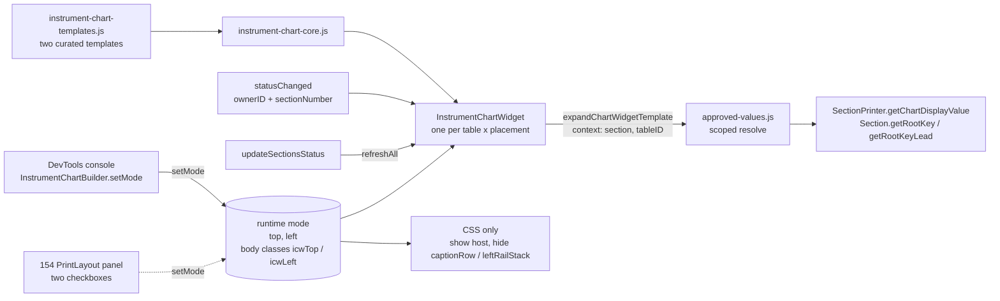

# sprint-153 Iteration 3: simplified implementation plan

Design: [153-design.md](153-design.md) (Iteration 3 section)  
Sprint: [sprint-153.md](sprint-153.md)  
Analysis: [153-it1-analysis.md](153-it1-analysis.md)  
Replaces (kept for reference): [153-it2-implementation-plan.md](153-it2-implementation-plan.md)  
Next sprint (depends on this one): [154-it2-implementation-plan.md](../154-print-layout/154-it2-implementation-plan.md), which needs a revision after this plan is accepted (section 9)

Status: **plan only, no code written.**  Per [sprints.md](../../../lifecycle/sprints.md) the files marked **CORE** need `CORE-APPROVED`.  The plan ends with questions (section 8) for the next review round.

Revision note: this file was updated in place after review.  The three follow-up decisions in the second table of section 1 (no tab, no editable templates, hide whole containers) are applied throughout.

---

## 1. What the Iteration 3 simplifications do to the plan

| # | Simplification | Effect |
|---|---|---|
| 1 | The two widget containers are for **print only**.  No per-Instrument buttons, no commands | **Removed:** `T` / `L` buttons, per-table flags `ChartTop` / `ChartLeft`, `Layout.screen` master flags, `/vh` `/vs` `/vt` commands, `noteTablesLayout` schema changes, `layout.js` / `menu.js` / `key-handlers.js` edits.  The it2 question about inheritance versus an explicit "off" **disappears** |
| 2 | The widgets *replace* what is in `.leftRailStack` and `.captionRow`.  Keep the existing elements; add siblings | Hosts are new siblings of the two existing containers.  The existing containers are hidden **as whole units** by one CSS rule each (see 3.2); nothing existing is moved or re-parented |
| 3 | The print panel has two checkboxes (`show left chart widget`, `show top chart widget`) instead of text entry as the on/off | The on/off state is **one global mode** (`{ top, left }`), not a per-table state.  153 provides the mode and a console API; the **checkboxes themselves are built in 154**, in the PrintLayout panel |
| 4, 5, 7 | Observers just follow the Main; the panel builds them; nothing to persist or choose | Widgets are **table-agnostic**: any table built by `TableBuilder.js` has the hosts, and each widget learns which Section its table shows from the existing `statusChanged` event.  **153 persists nothing** |
| 6 | Shorter default templates | Section 3.4 |

Follow-up decisions after reviewing the first version of this plan:

| Decision | Effect |
|---|---|
| Switch the mode **from the console** in 153; **no tab** | Removed: ChartWidgets tab, its HTML / builder / CSS, the `index.html` edit, the `showDesktopTab` refactor (moves to 154), the checkbox fragment.  Added: `window.InstrumentChartBuilder` (the same pattern `SectionStatusBuilder` already uses) |
| **No editable templates**.  Two curated single values (one vertical, one horizontal) in a module file under `./templates/` that developers edit | Removed: Song members `chartWidgetsTop/Left`, persistence, schema keys, runtime sanitizing of user text, editor, Reset button, `isDefault...` helper, persistence Jest tests.  **`SongPersistence.js` is no longer touched.**  Added: `templates/InstrumentChart/instrument-chart-templates.js`, shaped so 154 can later add siblings and a selector |
| Turning a widget on hides the **whole** `.captionRow` / the **whole** `.leftRailStack` | Confirmed; CSS only (3.2) |

Unchanged from it2: scoped expansion (the one real engine change), the new tokens, escaping of chart text, Jest approach, and "no Tool tables".

---

## 2. What exists today (verified in code) and what it changes

| # | Finding | Where | Consequence |
|---|---|---|---|
| F1 | `resolve()` takes no arguments; providers are installed once and read `getCurrentSection()` | [approved-values.js](../../../../approved-values.js#L83), [infinite-neck.js `installModuleProviders`](../../../../infinite-neck.js#L295) | Step 1 adds a `context` |
| F2 | `chartChordCaption` / `chartModeCaption` are empty placeholder spans, filled **by class** for the whole page by `updateSectionsStatus()` | [infinite-neck.js](../../../../infinite-neck.js#L998) | In a scoped expansion these names resolve to the scoped **text** (no `lblSection*` class), so the global fill cannot overwrite them |
| F3 | `SectionPrinter.getChartDisplayValue(value, kind, chartOptions, {section})` is already Section-scoped.  The stripped-root branch emits `<b class='chartTransposedRoot'>` | [section-printer.js](../../../../section-printer.js#L232) | Reuse; add an `escapeHtml` option so chart text is escaped but the generated `<b>` is not |
| F4 | `Section.getRootKey()` / `getRootKeyLead()` use the Section's own `sharps`; `rootIDLead` of `-1` falls back to the root | [Section.js](../../../../Section.js#L82) | Scoped `rootKey` / `rootKeyLead` call the Section |
| F5 | `updateSectionsStatus()` runs after every Section change and every chart edit | [infinite-neck.js](../../../../infinite-neck.js#L980) | Hook for `InstrumentChartBuilder.refreshAll()` (closes Iteration 1 hole H3, stale widgets) |
| F6 | `Widget:SectionStatus:statusChanged` is emitted per table by `replayTable()` with `ownerID` and `sectionNumber` (1-based).  The per-beat emitters carry no `sectionNumber` | [NoteTableController.js](../../../../NoteTableController.js#L1229) | The widget learns "which Section does my table show" from it, and ignores events without `sectionNumber` |
| F7 | **Left Rail DOM:** `td.tdLeftRailStack > div.leftRailStack > { div.leftRailCaptionHost#<id>_leftRailCaptionHost, span.leftRailSectionStatusHost#<id>_leftRailSectionStatusHost }`.  `Layout.toggleLeftRails()` shows or hides `.leftRailStack` as a whole (inline `display`) and `toggleCaptionLooperLayout()` sets its `flex-direction`.  The `C` / `S` buttons toggle the two children individually | [TableBuilder.js](../../../../TableBuilder.js#L228), [layout.js](../../../../layout.js#L105) | The natural parent to hide is **`.leftRailStack` itself**, which already is the Layout's unit of toggling.  The new host goes **beside** it in `td.tdLeftRailStack`.  Flex parentage inside the stack is untouched, and any future sibling of `.leftRailCaptionHost` is hidden along with it |
| F8 | **Caption row DOM:** non-Tool tables get `div.captionRow` as the first child of `.instrumentBackground`; `.instrumentBackground` is a column flex container; `Layout.toggleInstrumentCaptions()` toggles `.captionRow` with inline `display`.  Tool tables' caption row is a different structure (the `captionRow` class is on an inner span) | [TableBuilder.js](../../../../TableBuilder.js#L218), [instrument.css](../../../../instrument.css#L88) | New host is a **sibling inserted before** `.captionRow`, as a child of `.instrumentBackground`.  The hiding rule uses the direct-child selector `.instrumentBackground > .captionRow`, which cannot match a Tool table's inner span |
| F9 | The Layout's `display` toggles are inline styles | [layout.js](../../../../layout.js#L101) | A stylesheet rule with `!important` wins over an inline `display: block`, and removing the body class restores whatever the Layout last set.  **Nothing has to be saved or restored**, so the Layout, fullscreen and the widgets cannot get out of step |
| F10 | `SongWidgetsBuilder` imports `getSong` / `updateSectionsStatus` from `infinite-neck.js`; `SectionStatusBuilder` imports nothing from it | builders | The widget builder gets providers injected, so `TableBuilder.js` can import it with no import cycle |
| F11 | The sanitizer returns its input unchanged when there is no `document` (Node) | [html-sanitizer.js](../../../../html-sanitizer.js#L195) | The templates are now code constants, so **no runtime sanitizing** is needed.  A Jest guard still checks the **vocabulary** (the sanitizer is a no-op in Node, so calling it would test nothing): every tag is in `isAllowedSanitizerTag`, every class passes `isWhitelistedClass`, and every `${token}` is on a "safe in widgets" list (tokens that are numeric or HTML-escaped) |
| F12 | `bin/help.html-updater.js` regenerates the `/vdv` block in help.html; `bin/validate-command-menu.js` checks menus against the registry | [bin/](../../../../bin/help.html-updater.js) | Run the updater after Step 1 (no menu changes remain) |
| F13 | **Nothing ever calls** `SectionStatusBuilder.removeAll()` / `removeByOwnerID()`.  Every table rebuild leaves the old widgets registered and subscribed, writing into detached DOM | [section-status.builder.js](../../../../templates/SectionStatus/section-status.builder.js#L86), [infinite-neck.js `reinstallAllTuningsTables`](../../../../infinite-neck.js#L2565) | The new builder tears down on rebuild.  Fixing SectionStatus too is a one-line addition in the same place, and matters for 154's live re-tiling (Q4) |
| F14 | Desktop tabs are an if-chain in `showDesktopTab(which)` | [infinite-neck.js](../../../../infinite-neck.js#L4213) | **Not needed in 153** (no tab).  The table-driven refactor becomes a 154 item (section 9) |
| F15 | `SectionStatusBuilder` already publishes itself with `window.SectionStatusBuilder = SectionStatusBuilder` | [section-status.builder.js](../../../../templates/SectionStatus/section-status.builder.js#L326) | Precedent for DevTools access: `InstrumentChartBuilder` does the same, and the console is the 153 switch |
| F16 | `${currentSectionCardinal}`, `${beats}` / `${beatCount}`, `${getSectionCaption}`, `${rootKeyLead}` exist, all reading the current Section | [approved-values.js](../../../../approved-values.js#L95) | Make them scoped; the user's default templates use them |

---

## 3. What we build



### 3.1 Names (proposals, please confirm in Q5)

| Kind | Name |
|---|---|
| Template module (the two curated values; edit this file to change them) | `templates/InstrumentChart/instrument-chart-templates.js` |
| Host elements | `div.instrumentChartTop#<tableID>_chartTopHost`: first child of `.instrumentBackground`, before `.captionRow`.  `div.leftRailChartHost#<tableID>_chartLeftHost`: child of `td.tdLeftRailStack`, after `.leftRailStack` |
| Mode (runtime only, never persisted in 153) | `{ top: boolean, left: boolean }`; body classes `icwTop` / `icwLeft` |
| Widget placements | `'top'` (horizontal markup), `'left'` (vertical markup) |
| Module folder | `templates/InstrumentChart/` (templates, core, builder, css) |
| Console handle | `window.InstrumentChartBuilder` |

### 3.2 Visibility and "replace": CSS only, whole containers

The hosts are always built (empty and hidden) on every non-Tool table.  Everything else is one CSS block, keyed by the two body classes:

```css
.instrumentChartTop, .leftRailChartHost { display: none; }

/* Top: the host takes the place of the Instrument Caption Row */
body.icwTop .instrumentChartTop { display: block; }
body.icwTop .instrumentBackground > .captionRow { display: none !important; }

/* Left: the host takes the place of the whole Left Rail stack (caption + SectionStatus + whatever is added later) */
body.icwLeft .leftRailChartHost { display: block; }
body.icwLeft .tdLeftRailStack > .leftRailStack { display: none !important; }
```

Why this shape:

- The existing elements stay in the DOM and keep working: the hidden SectionStatus widget and caption role targets keep updating, so turning the mode off needs no refresh.
- Hiding `.leftRailStack` (not its two children) matches F7: that is the Layout's own toggled unit, and any future sibling of `.leftRailCaptionHost` is hidden with it.  `C`, `S` and `⇋` do nothing visible while `icwLeft` is on (they are print-irrelevant; the 154 panel is the control).
- `!important` beats the Layout's inline `display` (F9), and leaves it untouched for when the mode is off.
- No per-table or per-screen state exists, so a table rebuild, a Song load, or fullscreen cannot desync anything.
- `.instrumentChartTop` gets the same width and padding as `.captionRow` ([instrument.css](../../../../instrument.css#L88)); `.leftRailChartHost` is `min-width: 0; overflow-wrap: anywhere` so chord names such as `F#m7b5/C` wrap instead of widening the rail.

### 3.3 Variables (scoped set, unchanged from it2)

Every `/vdv` registry entry gets a `scope`:

| scope | Meaning | In an Instrument widget |
|---|---|---|
| `section` | Follows the Section the Instrument shows | Resolved from `context.section` |
| `song` | Same for every Instrument (song name, section count, BPM, opacities) | Resolved as today |
| `live` (default) | Current Section / beat / plugin state | **Blank**, because it would be wrong next to an Observer.  `/vdv` marks them "current Section only" |

| Token | scope | Notes |
|---|---|---|
| `chartChord`, `chartMode` | section | **New.**  Display text via `getChartDisplayValue(.., {section, escapeHtml: true})`.  Outside a context they use the current Section, so they also work in captions and SongWidgets |
| `chartChordCaption`, `chartModeCaption` | section | With a context: the scoped text (F2).  Without: unchanged placeholder spans |
| `rootKey`, `rootKeyLead` | section | `context.section.getRootKey()` / `getRootKeyLead()` |
| `rootKeys` | section | **New.**  Key, then `&#x2836;` and the Lead Key only when they differ; same format as Chart > Chart (`getSectionKeyDisplay` in section-printer.js) |
| `currentSectionNumber`, `currentSectionIndex`, `currentSectionCardinal` | section | From `context.sectionIndex` |
| `getSectionCaption` | section | Escaped plain text, expanded once more in the same context so a caption containing `${chartChord}` works (Q3) |
| `beats`, `beatCount` | section | `context.section.beats` |
| `instrumentCaption` | section | **New.**  The table's caption (`options.baseID`), from `context.instrumentCaption`.  Not used by the curated templates; available when someone edits them (Q1) |
| `sectionCount`, `getSongName`, `getBPM`, opacities, `graveyardRecordCount` | song | Unchanged |
| everything else, including the Tonal note tokens | live | Blank in widgets for now (Step 5 is optional) |

### 3.4 The two curated templates (the Iteration 3 text, verbatim)

They live in `templates/InstrumentChart/instrument-chart-templates.js`, as two named constants with a header comment that lists the allowed tags and which tokens are safe, and points at `/vdv` for the variables.  They are the only source: there is no Song override, no editor, and no persistence.  Only existing tags are used (`b`, `small`, `br`) and no classes:

```html
<!-- top (horizontal) -->
<b>${chartChord}</b>&nbsp;${chartMode}&nbsp;&nbsp;${rootKeys}&nbsp;&nbsp;&sect;${currentSectionCardinal}&nbsp;<small>${beats} beats</small>&nbsp;${getSectionCaption}&nbsp;

<!-- left (vertical) -->
<small>&sect;${currentSectionCardinal}</small><br><b>${chartChord}</b><br>${rootKeys}
```

Shape for later: a flat object `{ top: '...', left: '...' }` now.  When siblings arrive, the module becomes `{ top: { id: '...' }, ... }` choices that the 154 panel's selector reads, and `getChartWidgetTemplate(placement, id?)` already takes the optional second argument (ignored in 153), so callers do not change.  This plan builds none of that selector.

### 3.5 The mode and how it is switched

- `InstrumentChartBuilder.setMode({ top, left })` merges the given booleans into the current mode (so `setMode({ top: true })` leaves `left` as is), sets the two body classes, and calls `refreshAll()`.  `getMode()` reads it.  Not persisted, and reset to `{ top: false, left: false }` when a Song loads (Q7).
- 153 switch: the DevTools console, via `window.InstrumentChartBuilder` (F15):

  ```js
  InstrumentChartBuilder.setMode({ top: true, left: true });   // both on
  InstrumentChartBuilder.setMode({ top: false });              // top off again
  InstrumentChartBuilder.getMode();
  ```

- 154 builds the two checkboxes (`show left chart widget`, `show top chart widget`) in the PrintLayout panel and calls the same `setMode()`.
- A widget refreshes only while its placement is on (nothing is expanded or written to the DOM otherwise).  It always records the last `sectionNumber` it was told, so turning the mode on can fill every widget immediately.

---

## 4. Implementation steps

Each step ends with a check.  Steps 1-3 touch nothing under CORE and can be reviewed alone.

### Step 1. Scoped expansion, [approved-values.js](../../../../approved-values.js), [section-printer.js](../../../../section-printer.js)

- `expandApprovedTemplate(text, { preserveUnknown, context, live })` and `resolveApprovedValue(name, { logUnknown, context, live })`; `entry.resolve(context)`.  `live` is `'blank'` when a `context` is given, otherwise `'current'`.  No context means today's behavior, byte for byte.
- Entry field `scope` (`'section' | 'song'`, default `'live'`), declared on the entries in 3.3.
- Add entries `chartChord`, `chartMode`, `rootKeys`, `instrumentCaption`.
- Two new providers in `installModuleProviders`: `getChartDisplayValue` (wraps `SectionPrinter.getChartDisplayValue` with `escapeHtml: true`) and `getChartOptions` (`getSong().chartOptions`).  This keeps approved-values.js free of the Tonal import.
- `getChartDisplayValue(.., context)`: new `context.escapeHtml === true` escapes the text parts and never the generated `<b class='chartTransposedRoot'>`.  Existing callers unchanged.
- `listApprovedValues()` / `renderApprovedValuesReferenceHtml()` add the scope to each row (a "Per Instrument" column: section / song / "current Section only").
- Check: Jest (section 5).  Run `bin/help.html-updater.js` and `bin/validate-command-menu.js`.

### Step 2. Templates module and pure core, `templates/InstrumentChart/instrument-chart-templates.js`, `instrument-chart-core.js` (new)

- `instrument-chart-templates.js`: the two curated constants (3.4) and nothing else.  Exports `CHART_WIDGET_TEMPLATES = { top, left }`.  This is the file to edit to change the widgets.
- `instrument-chart-core.js`:
  - `getChartWidgetTemplate(placement, id)`: returns `CHART_WIDGET_TEMPLATES[placement]`; `id` is reserved for the later selector and ignored now.
  - `normalizeChartWidgetMode(raw)`: returns `{ top: boolean, left: boolean }` (merge semantics for `setMode`, and what 154 will persist).
  - `expandChartWidgetTemplate({ template, section, sectionIndex, tableID, instrumentCaption })`: calls `expandApprovedTemplate(template, { context })` and returns HTML.
- No DOM, no jQuery.
- Check: Jest, including the vocabulary guard (F11): extract every tag, `class` token and `${token}` from both templates and assert allowed tags, whitelisted classes, and tokens on the "safe in widgets" list.

### Step 3. Widget builder and CSS, `templates/InstrumentChart/instrument-chart.builder.js`, `.css` (new)

- `InstrumentChartBuilder`: `registry` by `ownerID`; `createWidget(hostEl, ownerID, placement, { instrumentCaption })`; `removeByOwnerID`; `removeAll`; `refreshAll()`; `setMode` / `getMode` (3.5); `setProviders({ getSong, getSection })`.  Providers are injected by `infinite-neck.js` so `TableBuilder.js` can import the builder without a cycle (F10).  At the end of the file: `if (typeof window !== 'undefined') window.InstrumentChartBuilder = InstrumentChartBuilder;` (F15).
- `InstrumentChartWidget`: remembers `sectionIndex`; subscribes to `Widget:SectionStatus:statusChanged`, handling only events with `ownerID === this.ownerID` and a `sectionNumber` (F6).  `refresh()` returns early unless its placement is on; otherwise it expands the curated template and writes the host only when the HTML changed.  No sanitizing step: the template is trusted code and chart text and captions are escaped by the expansion.
- The Main and Observers run the same code; each uses the Section from its own events.
- CSS: the 3.2 block, plus the host styling.
- Check: UI only (Step 4 acceptance).

### Step 4. Hosts, wiring, teardown, **CORE:** [TableBuilder.js](../../../../TableBuilder.js), [infinite-neck.js](../../../../infinite-neck.js)

- `buildNoteTable` (non-Tool only): create `div.instrumentChartTop#<tableID>_chartTopHost` and insert it **before** `captionRow` in `.instrumentBackground`; create `div.leftRailChartHost#<tableID>_chartLeftHost` and append it to `td1` **after** `.leftRailStack`.  Create the two widgets.  No existing element is moved, renamed, or re-parented.
- `infinite-neck.js`: import the builder (this also publishes `window.InstrumentChartBuilder`); inject the providers; call `InstrumentChartBuilder.refreshAll()` at the end of `updateSectionsStatus()` (F5); in `reinstallAllTuningsTables()` call `InstrumentChartBuilder.removeAll()` (and, recommended, `SectionStatusBuilder.removeAll()`, F13) before `target.empty()`.  On Song load, `setMode({ top: false, left: false })`.
- [index.html](../../../../index.html): one `<link>` for `instrument-chart.css` (the only change there).
- Check: UI acceptance (section 6).

### Step 5 (optional, decide in review). Tonal tokens scoped to the Section

The plugin tokens (`transposedChordNotes`, `...NotesFunctions`, `...LeadKeyFunctions`, `enharmonicChartModeNotes`) are what a per-Section print tile might one day want.  The context already carries `section`, but each builder in [TonalPlugin.js](../../../../plugins/tonal/TonalPlugin.js) calls `this.getCurrentSection(song)`.  Change: the provider forwards `context.section`; builders use `context.section ?? current`.  About 8 call sites, in a plugin plus its tests, so keep it a separate optional iteration (Q6).  The curated templates do not need it.

### Step 6. Docs

- [help.html](../../../../help.html): only the regenerated `/vdv` block (the new tokens and the "per Instrument" column).  The widgets are print-only and have no user surface until 154, so no user-facing help yet.
- Developer note in [sprint-153.md](sprint-153.md): how to switch the mode from the console and which file holds the templates.

---

## 5. Tests (Jest, non-browser per repo convention)

| File | Covers |
|---|---|
| `_tests/jest/approved-values-scoped.test.js` (new) | with a `context`: `rootKey` / `rootKeyLead` / `rootKeys` / `chartChord` / `chartMode` / `currentSectionCardinal` / `beats` / `getSectionCaption` / `instrumentCaption` follow `context.section`, not the current Section; `live` tokens blank, `song` tokens unchanged; without a context everything is identical to today; unknown token preserved; HTML in a chord (`<b>`) is escaped; scope appears in `listApprovedValues()` |
| [approved-values.test.js](../../../../_tests/jest/approved-values.test.js) | unchanged, must still pass |
| `_tests/jest/instrument-chart-core.test.js` (new) | the two templates equal the text in 3.4; vocabulary guard (F11): tags allowed, classes whitelisted, every `${token}` on the safe-in-widgets list; `getChartWidgetTemplate` returns each placement (and ignores an unknown `id`); `normalizeChartWidgetMode` (merge, non-booleans ignored); expansion of two different Sections in one run (the Observer case); a Section past the end yields blank-safe output rather than a throw |
| section-printer tests | `getChartDisplayValue` with `escapeHtml` for strip / add-root options; no change without it |
| `help.html-updater` / menu validation | run the two `bin/` scripts |

No Layout, persistence or schema tests are needed any more (nothing is persisted).  The full pre-checkin run is `node --experimental-vm-modules node_modules/.bin/jest _tests/jest/ --verbose --runInBand`.

---

## 6. UI acceptance script (on [songs/demo/superchart.json](../../../../songs/demo/superchart.json))

1. Open the Song.  In the DevTools console, `InstrumentChartBuilder.getMode()` returns `{ top: false, left: false }`; nothing about the Instruments changes (captions and Left Rails as before).
2. `InstrumentChartBuilder.setMode({ top: true })`: on **every** Instrument (Main and floated Observers) the caption row disappears and one line appears.  Observers show **their own** Section's chord, mode, key and section number; the Main shows the current Section.  Navigate: all lines follow.  `setMode({ top: false })`: the caption rows return exactly as they were.
3. `setMode({ left: true })`: every Left Rail is replaced by the three-line vertical widget (section, chord, keys).  `setMode({ left: false })`: the original stack returns, in the `row` or `column` arrangement it had.  Toggle `⇋` first and repeat: arrangement is preserved.
4. Hide the Instrument captions (`/vhwi`) and the Left Rails (`/vhwl`), then turn each widget on: the widgets still appear (they are independent of those toggles), and turning them off returns the Layout to what it was.
5. Edit a chord on the Main (ChartInput): the Main's widget updates at once; navigate so an Observer shows that Section: it shows the new chord.  Put a chord of `<b>x</b>` in a Section: it appears as text, not markup.
6. Edit a template in `instrument-chart-templates.js`, reload, turn the mode on: the new text shows (the "edit the module file" workflow).
7. Load another Song: the mode is back to `{ top: false, left: false }` and no widget errors appear in the console.
8. Save a Song with the widgets on: the saved file is identical to one saved with them off (nothing new in the file).
9. Narrowest Observer with the left widget on: the chord and keys wrap and do not widen the rail.

---

## 7. Files touched

| File | Change | CORE? |
|---|---|---|
| `approved-values.js`, `section-printer.js` | scoped expansion, tokens, escape option | no |
| `templates/InstrumentChart/*` (4 new files) | templates, core, builder, css | no |
| `index.html`, `help.html` | one `<link>`; regenerated `/vdv` block | no |
| **`TableBuilder.js`** | the two hosts and widgets (no buttons) | **CORE** |
| **`infinite-neck.js`** | import, providers, `refreshAll` hook, teardown, load reset | **CORE** |
| `layout.js`, `menu.js`, `key-handlers.js`, `Song.js`, `SongPersistence.js`, `NoteTableController.js`, `html-sanitizer.js`, `bin/song-file-schema.js` | **not touched** | |
| `plugins/tonal/TonalPlugin.js` | Step 5 only, if approved | no |

Compared with it2: no `layout.js`, `menu.js`, `key-handlers.js`, `SongPersistence.js`, schema, tab or editor; two CORE files instead of three, with smaller edits in them; one fewer Jest area.

---

## 8. Questions for the review round

Resolved since the first version of this plan (no longer questions): no ChartWidgets tab and console switching (153); no editable templates and no persistence; hiding whole containers is fine.

- **Q1. `${instrumentCaption}`.**  Ship the token (not used by the curated templates), so whoever edits the template file can add the Instrument name?
- **Q2. The two templates.**  Verbatim from the design doc (3.4).  The Top one ends with `&nbsp;` after `${getSectionCaption}`; the Left one has no mode and no beat count.  Confirm.
- **Q3. `live` tokens and captions.**  Blank (not echo literally) song-wide `live` tokens such as plugin status inside widgets; and `getSectionCaption` expanded once in the widget's context (recommended) or inserted as raw escaped text.
- **Q4. SectionStatus leak (F13).**  Also call `SectionStatusBuilder.removeAll()` before each table rebuild in this sprint?  Recommended: yes, one line, same place.
- **Q5. Names.**  Confirm `instrumentChartTop`, `leftRailChartHost`, `icwTop` / `icwLeft`, `templates/InstrumentChart/`, and `window.InstrumentChartBuilder`.
- **Q6. Step 5.**  Scope the Tonal tokens in this sprint, or leave for later?
- **Q7. Mode semantics.**  `setMode` merges partial input (`{ top: true }` leaves `left` alone), and the mode resets to off at every Song load in 153 (154 re-applies it from its persisted panel choices).  OK?
- **Q8. The template file shape.**  A flat `{ top, left }` of two strings now; the 154 selector later changes the file to named choices without changing callers (3.4).  OK, or would you rather start with named choices now?

## 9. What this changes in the Sprint 154 plan

To fold into a revised [154-it2-implementation-plan.md](../154-print-layout/154-it2-implementation-plan.md):

- "Re-sync widgets from Main" and the copying of `CaptionLeft` / `SectionStatusLeft` / `ChartTop` / `ChartLeft` to tiles are **not needed**: the widgets are a global mode, so every tile follows automatically, and no per-tile flag exists.
- The PrintLayout panel **builds** the two checkboxes (`show left chart widget`, `show top chart widget`) and calls `InstrumentChartBuilder.setMode()` on change, enter, leave and Song load.  It persists `chartTop` / `chartLeft` in `layout.screenList.print.grid`.  (153 has no checkbox fragment to reuse.)
- 154 owns the **table-driven `showDesktopTab`** refactor (it adds the only new tab), and later the template selector (a select that reads the named choices in `instrument-chart-templates.js`).
- The proposed `print` screen flags `ChartWidgetsTop` / `ChartWidgetsLeft` are dropped; `CaptionRow`, `InstrumentCaptions` and `LeftRails` flags still apply, but they become irrelevant to the hidden containers while a widget is on.
- Tiles are always built by `TableBuilder.js`, so they get the hosts for free; 154 only has to make sure each tile's first `statusChanged` has been received (or a replay happens) after it builds the tiles (H1).
- `removeAll()` teardown on rebuild exists (F13) from this sprint.
- The `SongPersistence.js` change in the 154 plan is unaffected (it filters tiles, not widgets).

## 10. Holes opened by this plan

| # | Hole | Proposed handling |
|---|---|---|
| H1 | A freshly built widget knows no Section until its table's first `statusChanged` (for example, new tiles in 154) | The widget falls back to the current Section for a Main and shows blank otherwise; 154 verifies that building tiles is followed by a replay, or triggers one |
| H2 | The Left host is narrow; long chords or a long `rootKeys` could widen the rail | wrap with `min-width: 0` and `overflow-wrap: anywhere`; verify on the narrowest Observer (acceptance 9) |
| H3 | `refreshAll()` runs on every `updateSectionsStatus()` | skipped while the mode is off; when on it is cheap string work and writes DOM only when the HTML changed |
| H4 | While a widget replaces the caption row, the caption-row buttons (Float, Tuning, Tonal, wiring) are unreachable | accepted (print-only); turning the widget off restores them |
| H5 | Hosts and widgets exist on every non-Tool table, even when the mode is never used | empty, hidden, and not refreshed while off (H3); each rebuild tears them down (Step 4) |
| H6 | Tool tables get no hosts, but 154 hides them anyway | consistent; noted in the 154 plan |
| H7 | Template edits take effect only after a reload (module constant) | accepted; the selector in 154 can later expose several |
| H8 | A template author could add an unescaped token (for example `${getSongName}`) | the Jest vocabulary guard fails on tokens outside the safe-in-widgets list |
| H9 | Nothing in the UI shows the widgets until 154 (console only), so they can sit unused | accepted; 153 is the engine, 154 is the control panel |

## 11. Suggested iteration breakdown

1. **Iteration 4:** Steps 1-2 and their Jest tests (no UI, no CORE).  Review: tokens, templates.
2. **Iteration 5:** Steps 3, 4 and 6 (needs CORE-APPROVED for `TableBuilder.js` and `infinite-neck.js`); acceptance script items 1-9, switched from the console.
3. **Iteration 6 (optional):** Step 5.

Sprint 154 starts its implementation after Iteration 5, because it needs the hosts and the mode.
