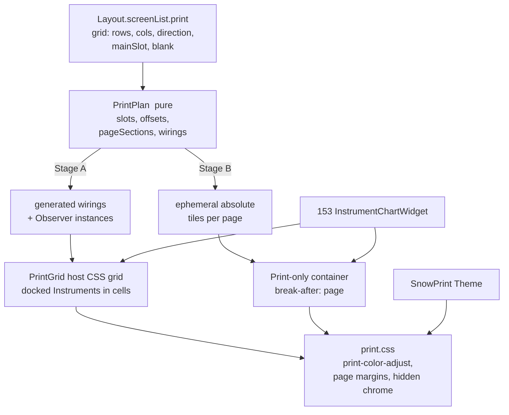

# Sprint 154 (print-layout), Iteration 1: high-level analysis

date: 20261103

Requested by [154-design.md](154-design.md), section "Iteration 1".  Sprint overview: [sprint-154.md](sprint-154.md).  Companion analysis: [153-it1-analysis.md](../153-instrument-chart-widgets/153-it1-analysis.md), which this sprint depends on (per-Instrument chart widgets, scoped variables, flag inheritance).

No code under `./` was changed for this analysis.  Statements about the code were read from the files linked below.

## 1. Verdict

Feasible, and the existing Observer machinery is a good engine for it.  But `superchart.json` hides four things that a real print layout cannot hide:

1. **Floated Instruments are `position: fixed` windows measured in percent of the viewport** ([dockable.js `makeDivDockable`](../../../../dockable.js#L284)).  That is great for a screenshot and wrong for browser printing: fixed elements do not flow across pages, and the printed viewport is the page, not the screen.  A print layout should use *docked* Instruments inside a CSS grid, not floats.
2. **Relative Sections wrap, they do not go blank.**  `-1` ... `-5` wrap around the song ([Song.js](../../../../Song.js#L759)); `^n` clamps to Section 1; `&n` clamps to the last Section.  Nothing yields "empty cell".  `superchart.json` works only when the cursor is on Section 6, 12, 18, ...
3. **The mockup is a sliding window, not a page.**  With backward Observers, Section 7 shows 2-7, not a new page.  Paging needs either a rule ("go to 6, 12, 18") or a page-aware layout.
4. **Observers take their Display Options from the *current* Section, not from their own Section** ([NoteTableController.js `replayTable`](../../../../NoteTableController.js#L1224)).  On a printed page with several Sections, per-Section themes, hide flags and fonts would apply to the wrong tiles.

Recommendation in one sentence: add a pure **Print Plan** (rows, columns, direction, main slot, blank policy) that *generates* ordinary Observer wirings and, for multi-page output, ephemeral absolute-Section tiles; render them into a **CSS grid** on a new `print` screen of `Layout`; ship a built-in print Theme; and defer the "scaling" question to a cheap browser-print spike before any implementation.

## 2. Current behavior (what exists today)

| Concern | Where | Behavior |
|---|---|---|
| Print support | CSS in `./` | **No `@media print` or `@page` rules** in the app CSS (the matches in the repository are unrelated documents under `r/`).  Printing is by screenshot of Fullscreen with Grabbles off |
| Observers | [Wiring.js](../../../../Wiring.js), [NoteTableController.js](../../../../NoteTableController.js#L1133) | `wirings[]` entry with `relativeSection` makes a table an Observer: it replays the Main's notes (`listenToTablename`) for the resolved Section; Observers reject note clicks |
| Relative Section grammar | [Song.js](../../../../Song.js#L735) | `+n`/`-n` wrap; `0` first; `n` absolute (clamped); `^n` backward no-wrap; `&n` forward no-wrap; `@n` previously played; there is a `Direction.EMPTY` code, but it resolves to the **current** Section |
| Floating | [dockable.js](../../../../dockable.js#L284) | `position: fixed`, `left/top/width/height` in % of the viewport, `zIndex`, drag handle (the "Grabbles"), `resize: both`, `overflow: auto`, own border, radius and shadow; appended to `document.body` |
| Docking | [dockable.js `dockDivInPage`](../../../../dockable.js#L430) | Moves the div back to the remembered parent and next sibling |
| Persistence of placement | `noteTablesLayout[].anchorage` | `{floated, floatRect{left,top,width,height}, zIndex}` per table |
| Screens | [layout.js](../../../../layout.js) | `screenList.fullscreen` and `screenList.escaped`; flags `CaptionRow`, `SongTitle`, `SongWidgets`, `WidgetRow`, `InstrumentCaptions`, `LeftRails`, `CaptionLooperLayout`; `enterFullscreen()` / `leaveFullscreen()` call `doToggles()`.  `screen` is matched by `name`, so a third entry works with the same re-link logic |
| Instrument size | [infinite-neck.css](../../../../infinite-neck.css#L13) | Driven by note font and padding variables in `pt`/`rem` (for example `--named-note-font-size: 22pt`) and Theme values; **not** by the size of a container.  A floated window only holds or crops the Instrument |
| Themes | [themes.js](../../../../themes.js), `userTheme` in the Song | `superchart.json` uses `userTheme` with `baseid: "Snow"` and heavier `noteWhiteKeyShadowColor` / `noteBlackKeyShadowColor` (`"0 0 2pt 1pt black"`), `cellSpacing`, `instrumentBackground: white`.  Per-table Theme override exists (`options.themeInEffect`, Sprint 146) |
| Tunings | `myTunings[]` | `superchart.json` stores six near-identical full tuning objects (`instance: true`, `fromBaseID: "P46"`), about 40 lines each |
| Wirings | `wirings[]` | five entries, `relativeSection` `-1` to `-5`, `listenToTablename: "tblP46_1"` |

## 3. Findings that shape the design

### 3.1 Print mechanism: browser print versus screenshot

Browser printing gives vector output, user-chosen paper, orientation and scale, headers/footers from the browser, and multi-page output.  It costs us a print stylesheet and a layout that does not depend on viewport-percent positioning.  Because only `@page` and the print dialog know the paper size, we keep the wishlist rule: **portrait/landscape is the system dialog's job**, and the layout must tolerate any aspect ratio (CSS grid with `fr` tracks does).

What the browser will *not* do for us:

- **Backgrounds and some colors are dropped by default** unless `print-color-adjust: exact` (and the `-webkit-` form) is set on the print root.  Theme-colored cells need it; so does the Theme's `instrumentBackground`.  Verify box-shadow cell borders print as expected; they are the heart of the "darker shadow lines" Theme.
- **Scaling Instruments to a cell.**  Instruments are sized by pt/rem variables, not by their container (section 2).  Fitting 2x3 or 2x4 tiles to a page needs one of: CSS `zoom` per tile, `transform: scale()` with a measured wrapper, a single `--print-scale` variable feeding the note-size variables, or container-query units.  This is the **single biggest unknown**; see the spike in section 7.
- **Fixed-position elements** (our floats) are not part of normal flow, so a float-based layout cannot paginate.

Recommendation: implement browser print, keep screenshots working (they are the escape hatch).

### 3.2 Table versus flex versus grid

| Option | For | Against |
|---|---|---|
| `<table>` | Equal rows/columns by default | Semantics are wrong for a layout, row heights follow the tallest tile, awkward to break across pages |
| Flex with wrap | Simple | Cannot guarantee `cols` x `rows`; the last row stretches or ragged |
| **CSS grid** | Exact `repeat(cols, 1fr)` tracks, `gap`, `break-inside: avoid`, trivial to flip direction (`grid-auto-flow`), `fr` handles any aspect ratio | Needs `min-width: 0` on tiles so wide content does not blow the track |

Recommendation: CSS grid.  Use `grid-template-columns: repeat(var(--print-cols), minmax(0, 1fr))` and `grid-auto-rows: 1fr` so every tile is the same size.

### 3.3 Forward versus backward Observers

| | Backward (`-n`; `superchart.json`) | Forward (`+n`) |
|---|---|---|
| Main Instrument sits at | last tile (bottom right) | first tile (top left) |
| Cursor on Section N shows | N-5 ... N (sliding window) | N ... N+5 |
| Natural paging | land on 6, 12, 18 | land on 1, 7, 13 (page starts) |
| End of song | complete pages, but the first page has wrapped nonsense unless you start at 6 | last page is partial, so blanks are required |
| Reading order | tile order matches Sections, the Main is the *last* one | Main is the first, which is where you play |

Recommendation: **forward is the default**, because pages begin on the Section where you are, the Main stays top-left (a stable place, which also helps the 153 widgets), and the only extra rule is "blank after the last Section".  Generalize with `mainSlot` (index of the tile that is the Main) so backward is just `mainSlot = N-1`.  The plan then computes every Observer's offset as `slot - mainSlot`.

### 3.4 Where blank cells and paging come from

The plan, not each wiring, owns paging:

- `pageSections(currentIndex, rows, cols, mainSlot, blankPolicy)` returns for each slot a Section index or `null`.
- Blank policies: `blank` (empty tile), `wrap` (current behavior, mostly for compatibility testing), `clamp` (repeat the edge Section).  Default `blank`.
- Navigation helper: "next/previous page" moves the cursor by `rows*cols` (this is what the user is doing by hand with `superchart.json`).

To get `blank` through the **existing** wiring engine, either extend the relative grammar with a no-wrap forward/backward form that returns *no Section* when out of range (the `EMPTY` direction is already reserved), or let the plan hide the tile.  The second is less invasive: the plan sets the tile's visibility (or a `printBlank` class) from `pageSections()`, and the wiring stays as a plain `+n`.  Recommend the second.

### 3.5 Generate wirings or make tiles ephemeral?

Two different needs:

- **On-screen "page view"** (what `superchart.json` is): persisted Observers, live with the cursor, screenshot-able.
- **Print the whole song**, for example 20 Sections on 4 pages, without navigating: needs tiles for Sections that are not near the cursor.

Recommendation: a two-stage plan.

1. **Stage A, page view.**  The Plan *generates* ordinary wirings and Instruments (`generatedBy: "printLayout"`), with `relativeSection` `+k` / `-k` for slots, placed into a grid on the `print` screen.  Reuses everything already tested.
2. **Stage B, print all.**  On "Print", build **ephemeral absolute tiles** (`relativeSection: "7"` style, or direct replay of a Section index) for every page into a print-only container, `break-after: page` between pages, `window.print()`, and remove on `afterprint`.  No persistence.  Absolute tiles do not depend on the cursor, so the cursor never has to be moved.

Stage A can ship without B.  B needs a replay path that is not tied to `getCurrentSection()` (finding 3.8), so it is the larger piece.

### 3.6 Storage

Make `print` a **third screen** in `Layout.screenList`: `fullscreen`, `escaped`, `print`.  The screen already carries the visibility flags that print needs (`InstrumentCaptions: false`, `CaptionRow: false`, `LeftRails`, the 153 chart widget flags, `SongWidgets`), persists per Song, and has toggling machinery.  Add one sub-object:

```
layout.screenList.print = {
  name: "print",
  ...existing flags...,
  grid: { rows: 2, cols: 3, direction: "forward", mainSlot: 0, blank: "blank", mainTableID: "tblP46_1" }
}
```

That is the minimal, elegant stored form: **five numbers/strings**.  Everything else (Observer tuning copies, wirings, relative strings) is derived.

For the Observers, avoid repeating widget flags (see 153, section 4.5): an Observer with no `noteTablesLayout` flags **inherits** those of its `listenToTablename`.  Generated Observers then need only the wiring and the tuning instance.  The open question "reference to the Main's layout versus copying it" is answered as: *reference by inheritance at read time, never copy*.  The Plan writes wirings and nothing else.

Also consider de-duplicating the tuning copies: a generated Observer could persist as `{instance: true, baseID, fromBaseID, generatedBy}` and be rehydrated from the Main's options on load.  That would shrink `superchart.json` by about 200 lines.  It touches persistence of instance tunings, so list it as optional (H8).

### 3.7 Theme

Promote the `superchart.json` `userTheme` to a **built-in Theme** (for example `SnowPrint`) in [themes.js](../../../../themes.js) instead of copying `userTheme` into each song.  Note that `noteWhiteKeyShadowColor` actually holds a full box-shadow value (`"0 0 2pt 1pt black"`); the Theme should state that and the print Theme should not rely on names.  The print screen may optionally name a Theme to apply while in print mode (`screen.print.theme`), but that collides with `allowThemeAutomation` and per-Section `sectionTheme`; keep it manual in the first iteration and revisit.

### 3.8 Engine limits to know about

- `replayTable` and `getReplaySection` are driven by `getCurrentSection()` or a relative string; an Observer's Display Options come from the **current** Section (`getDisplayOptionsInEffect(getCurrentSection(), ...)`).  For a page with mixed per-Section display options, tiles would be wrong.  Needed for correctness: resolve the Display Options for the Observer's Section (this interacts with the Sprint 148 cascade; ask before changing).
- `Song.gSectionsCurrentIndex` is global; Stage B needs a replay entry point taking an explicit Section index.
- Instrument ids and `noteTablesLayout` are keyed by `tableID` (`tblP46_2`); generated ids must be stable and collision-free (for example `<mainBaseID>_<slot>`).

### 3.8a What a printed tile must hide

SectionStatus carries interactive pieces (record dot, loop light, beat counter) and the relative label (`-3`).  On paper the useful label is the absolute Section number or the Section caption.  Provide a print variant (CSS under the `print` screen's root class is enough) and let the 153 widgets carry the chart info.

## 4. Recommended design

### 4.1 Pieces



### 4.2 Pure module: the Print Plan

`printlayout.js` (no DOM, no jQuery, Jest-friendly, as with `displayOptionsCellRules.js`):

- `normalizeGrid({rows, cols, direction, mainSlot, blank})`
- `slotOffsets(grid)` returns an offset per slot (`slot - mainSlot`, forward or backward)
- `wiringForSlot(offset)` returns `"+3"` or `"-2"` (and `""` for the main)
- `pageSections(currentIndex, sectionCount, grid)` returns `[sectionIndexOrNull]`
- `pageCount(sectionCount, grid)`, `pageStartForSection(index, grid)`
- `planObservers(grid, mainTableID, existingWirings)` returns `{add, remove, keep}`; only entries with `generatedBy: "printLayout"` are ever removed, so hand-made Observers are untouched

### 4.3 DOM and orchestration (new)

`templates/printlayout/printlayout.builder.js|.html|.css`: the configuration panel (rows, columns, direction, main slot, blank policy, page navigation, Print button), the grid host, enter/leave of the print screen, and the Stage B tile builder.  It uses `TableBuilder` to make tiles, `SectionStatusBuilder` / 153 `InstrumentChartBuilder` for widgets, and dockable APIs only to dock, never to float.

`print.css` (or a section in infinite-neck.css): `@page` margins, `@media print` hiding everything outside the grid host, `print-color-adjust: exact`, `break-inside: avoid` on tiles, `.printBlank` hiding, tile scale variable.

### 4.4 Entering and leaving

`Layout.enterPrint()` / `leavePrint()` alongside `enterFullscreen()`, calling `doToggles()`; on enter: dock any floated Instrument that is part of the plan, force Grabbles off (it is already forced off in Fullscreen, see `fixDockableHandlesIfFullscreen`), apply the plan, move Instruments into grid cells (ids are stable, and handlers keyed by id or delegated survive a move; verify for the direct `onclick="floatNoteTableDiv(...)"` buttons), and add a root class (for example `printScreen`).  On leave: reverse.

### 4.5 Commands

Existing convention is a `/v..` family (`/vpm`, `/vdd`, `/vdv`).  Add a small set for the plan (names to decide): open the panel, set grid, next/previous page, print.  No keystroke is needed in the first iteration.

## 5. New modules and broad-stroke members

| Item | New / changed | Purpose |
|---|---|---|
| `printlayout.js` | new, pure | Print Plan (section 4.2) |
| `templates/printlayout/*` | new | panel, grid host, Stage B tile builder |
| `print.css` | new (or section of infinite-neck.css) | print rules |
| [layout.js](../../../../layout.js) | changed | third screen `print`, `enterPrint()`, `leavePrint()`, grid sub-object defaults |
| [themes.js](../../../../themes.js) | changed | built-in print Theme |
| [Wiring.js](../../../../Wiring.js) | changed | optional `generatedBy` marker |
| [Song.js](../../../../Song.js) | changed | helpers to add/remove generated Observers; optional blank-aware relative resolution |
| [NoteTableController.js](../../../../NoteTableController.js) | changed (Stage B and 3.8) | replay by explicit Section index; Display Options from the tile's own Section |
| [TableBuilder.js](../../../../TableBuilder.js) | changed | tile-friendly build (no caption row buttons in print) |
| [SongPersistence.js](../../../../SongPersistence.js), [bin/song-file-schema.js](../../../../bin/song-file-schema.js) | changed | `layout.screenList.print.grid`, `generatedBy` |
| [key-handlers.js](../../../../key-handlers.js), [menu.js](../../../../menu.js) | changed | commands |
| `_tests/jest/printlayout.test.js` | new | plan math: offsets, forward/backward, `mainSlot`, partial last page, 1-row/1-col, `planObservers` diff; no JSDom |
| [help.html](../../../../help.html) | changed | document printing |

## 6. Holes and open decisions

| # | Hole | Options / recommendation |
|---|---|---|
| H1 | Does a float-free docked grid look right after reparenting? | Spike (section 7): move six `div<tableID>` into a grid by hand |
| H2 | Scaling Instruments to tile size | Candidates in 3.1; decide after the spike.  Expect a single `--print-scale` variable |
| H3 | Blank cells | Plan-owned visibility (3.4); do not overload the relative grammar |
| H4 | Sliding versus paged navigation | Paging commands move by `rows*cols`; free navigation still slides, which is fine and documented |
| H5 | Display Options come from the current Section | Resolve from the tile's Section; needs care with the Sprint 148 cascade |
| H6 | Multi-Instrument songs (Guitar and Piano per Section) | Version 1 is one Main Instrument per tile.  A tile that stacks several Instruments for one Section is a later design |
| H7 | Per-Section data that is not on the Instrument (Section caption, beats, notes text) | 153 widgets cover chart info; add `${getSectionCaption}`, `${beats}` scoped tokens to the default print widget |
| H8 | Duplicated tuning instances in the song file | Optional minimal persistence for generated Observers; otherwise accept the redundancy |
| H9 | Page header and footer (song title, "page 2 of 4") | Own header element in the print container; `@page` margin boxes are not reliable cross-browser |
| H10 | Regenerate semantics when rows/cols change | Only `generatedBy` Observers are changed; undo is a known gap |
| H11 | Print Theme coupling with `allowThemeAutomation` / `sectionTheme` | Manual Theme choice in iteration 2; revisit automation |
| H12 | Ink use (dark backgrounds, colored cells) | Print Theme is white; offer a "grayscale" note about printers; do not build more |
| H13 | Stage B memory/time for long songs | Build one page at a time and clone, or measure with the existing timing marks first |
| H14 | Chrome, Firefox and Safari differ in `print-color-adjust`, `zoom`, `break-*` | Test the spike in at least two engines |
| H15 | Tool tables, Listener tables inside a plan | Exclude from the plan in version 1 |

## 7. Suggested next steps

1. **Spike, no app code.**  Take `superchart.json`; in the dev tools, dock its six Instruments, put them in a CSS grid host, add `@media print { ... print-color-adjust: exact }`, and print preview in Chrome and Firefox at Letter portrait and landscape.  Record: does the shadow-line Theme print, how do Instruments scale, what breaks.  This answers H1, H2, H14 and settles section 3.1's "does printing from the browser give the right control".
2. **153 first slice**: scope-aware `expandApprovedTemplate` and the flag inheritance helper (see [153-it1-analysis.md](../153-instrument-chart-widgets/153-it1-analysis.md)), because print tiles need them.
3. **Iteration 2 of this sprint**: `printlayout.js` with Jest (pure plan), then `Layout` print screen and Stage A on `superchart.json` (replace the hand-dragged floats by a generated 2x3 plan).
4. **Then** the print Theme and `print.css` from the spike; **Stage B** (print all pages) after H5 is settled.
5. **Decisions needed before coding:** forward as the default (3.3), plan-owned blanks (3.4), `print` as a third `Layout` screen (3.6), inheritance instead of copy for Observer layout (3.6), and whether Stage B is in scope for this sprint or the next.
