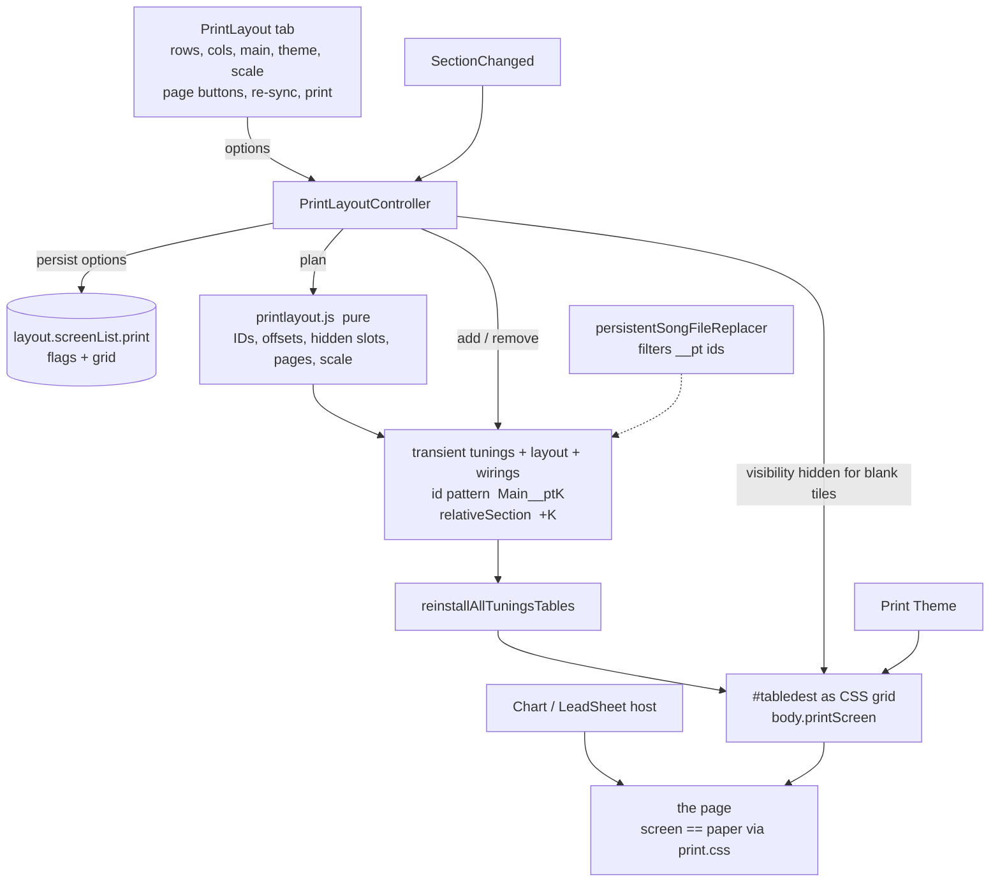

# sprint-154 Iteration 2: first-draft implementation plan

Design: [154-design.md](154-design.md) (Iteration 2 section)  
Sprint: [sprint-154.md](sprint-154.md)  
Analysis: [154-it1-analysis.md](154-it1-analysis.md)  
Depends on: [153-it2-implementation-plan.md](../153-instrument-chart-widgets/153-it2-implementation-plan.md)

Status: **plan only, no code written.**  Files marked **CORE** need `CORE-APPROVED` ([sprints.md](../../../lifecycle/sprints.md)).

**Gate before coding.**  Sprint 153 lands first.  This plan was written against the code as it is *before* 153.  After 153 merges, re-verify the items in section 4 ("Re-verify after 153") before the implementation round starts.

---

## 1. Decisions carried in from Iteration 2

| Topic | Decision |
|---|---|
| Layout vs Print Preview | One thing: Layout `print` is the preview.  It is live (follows the Transport), a real mode, with "temporary" Observers in "temporary" tiles that all mimic the Main |
| Float | Not supported.  Everything is docked |
| Tool tables, Listeners | Out of scope.  One Main Instrument |
| Tiling | CSS Grid.  Direction **forward only**.  Blank policy **`blank` only**, and the plan hides the tile |
| Observer management | The system clones the needed Observers to match the Main.  The only control is one panel, which changes all at once (for example 2x3 to 2x4) and throws them away.  Regenerate yes, undo no |
| Persistence | Only the panel's choices persist.  Nothing about the tiles goes into the Song file.  Stage B (print every page without navigating) is a **later** sprint |
| Stage A | On-screen page view, as above |
| Paging | Transport slides.  The panel has a NextPage (and Previous) button that moves by `rows*cols` |
| DisplayOptions | Every tile uses the Main's DisplayOptions.  Per-table, per-Section DisplayOptions are out of scope |
| Theme | One Theme for the whole preview: the default, or one chosen in the panel; default `Print` (a built-in descended from `Snow`).  `allowThemeAutomation` and Section / table Themes are ignored while in `print` |
| Colors | Stylesheet and AutoColor printing is the author's job; a Stylesheet or Look must stay selectable in `print` |
| Widgets | `T` and `L` live on the Main; the panel copies their state to the tiles ("even if a manual click is needed to re-sync").  SectionStatus and Caption row are turned off by the User on the Main, with no special control.  Caption allowed in the Top (horizontal) widget |
| Scale | A single `--print-scale` variable |
| Chart | The existing Chart / LeadSheet / Line / "Show Next Line" choices apply on the page |
| Headers / footers | None for now |
| Panel | New Tab "PrintLayout" next to SongWidgets / ChartWidgets.  GUI first; command line and Macros later, **except** show/hide/toggle siblings for Layout elements (for example `/vtw?`) |
| Spike | A DevTools recipe for the browser-print investigation (section 5) |

---

## 2. Points to confirm (the notes pull two ways)

| # | Point | Reading used in this plan |
|---|---|---|
| C1 | "H5: Resolve from tile's Section" versus "3.8: use the Main's DisplayOptions" and the simplification at the top | **Main's DisplayOptions for every tile.**  That is what `replayTable` does today for Observers (it passes `getCurrentSection()` to `getDisplayOptionsInEffect`), so **no engine change** is needed |
| C2 | "Is Print fullscreen?" ("really just fullscreen but knows it is `print`") versus "changing the PrintLayout tab affects the Layout live" | The panel lives in `.container`, which fullscreen **hides**.  So `print` must be usable **without** fullscreen (menus stay, so the panel stays), and fullscreen is an optional "clean preview" on top.  Details in 3.3 |
| C3 | "Not even sure anything goes in the persisted Song file" versus "tiling options stored as properties of the panel" | The panel's options persist in `layout.screenList.print` (a Layout screen is already persisted per Song); tiles never do |

---

## 3. What exists today (verified) and what it changes

| # | Finding | Where | Consequence |
|---|---|---|---|
| F1 | Fullscreen = `.container` hidden.  `#divFullscreenChartHost` and `#divFullscreenLeadSheetLineHost` are **outside** `.container` and show only when `isFullscreenActive() \|\| isStrictTutorial()` | [infinite-neck.js](../../../../infinite-neck.js#L1753) | The Chart variants already work on a page; `print` only needs to be added to those conditions (one predicate, about 6 sites) |
| F2 | `#tabledest { display: inline-block }` and `.instrumentBackgroundOuter { width: 100vw; max-width: 100vw; overflow-x: auto }`.  Each Instrument is a full-width block | [instrument.css](../../../../instrument.css#L44) | Grid needs overrides scoped under `body.printScreen` |
| F3 | Tables are built from `myTunings` in array order into `#tabledest` by `installAllTuningsTables()`; hidden tables are `display:none` inside their outer div, which would still occupy a grid cell | [infinite-neck.js](../../../../infinite-neck.js#L2517) | Use CSS `order` for tile order; hide non-plan tables on the outer div |
| F4 | `getReplayOptionsArray()` iterates `getSong().getVisibleTunings()` (from `noteTablesLayout`) and reads `wirings`.  `getTuningByTableID()` looks tunings up in `song.myTunings` | [NoteTableController.js](../../../../NoteTableController.js#L1130), [L123](../../../../NoteTableController.js#L123) | Tiles that are **not** in the model need engine hooks in about four CORE places.  Tiles that are in the model work with **no** engine change (Option T, 4.1) |
| F5 | One serialization point: `JSON.stringify(this, SongPersistence.persistentSongFileReplacer, 2)`.  `Wiring.toJSON()` already writes only three fields.  `ensureNoteTablesLayout()` keeps unknown `true` flags | [Song.js](../../../../Song.js#L56), [Wiring.js](../../../../Wiring.js), [SongPersistence.js](../../../../SongPersistence.js#L381) | Tiles can be filtered at save by their id pattern in the replacer |
| F6 | `replayTable()` for an Observer calls `getDisplayOptionsInEffect(getCurrentSection(), ...)`, i.e. the Main's | [NoteTableController.js](../../../../NoteTableController.js#L1223) | C1: nothing to do |
| F7 | Relative Sections wrap for `+n`.  A tile past the end would show Section 1 | [Song.js](../../../../Song.js#L759) | The plan hides those tiles (`blank` policy); the wiring stays a plain `+k` |
| F8 | `Layout.enterFullscreen()` / `leaveFullscreen()` pick `screenList.fullscreen` / `escaped` and call `doToggles()`; the constructor re-links `screen` by `name` | [layout.js](../../../../layout.js#L146) | `print` needs a runtime "printActive" so entering or leaving fullscreen keeps `screen = print`.  A saved `screen.name === 'print'` must not auto-resume (no tiles exist at load) |
| F9 | `Song.gotoSection(idx)` publishes `SectionChanged` on the EventBus (`{sectionIndex}`) | [Song.js](../../../../Song.js#L1275) | NextPage uses it; the panel's page label and the blank tiles listen to `SectionChanged` |
| F10 | Theme change is `$('#selThemes').val(x).trigger('change')`, which ends in `Song.theme = ...`; automation is applied in `displayOptionsToControls()` when `getSong().allowThemeAutomation` | [infinite-neck.js](../../../../infinite-neck.js#L3484), [Song.js](../../../../Song.js#L1780) | Applying `Print` through the select would write `song.theme`.  Save the previous value and restore it on leave and in `updateMemoryModelPreFileSave()`; guard the automation line (Step 8) |
| F11 | **Nothing ever calls** `SectionStatusBuilder.removeAll()`; every table rebuild leaves its widgets subscribed to the EventBus | [section-status.builder.js](../../../../templates/SectionStatus/section-status.builder.js#L86) | Live re-tiling rebuilds tables on each change, so this leak must be fixed before 154 (see 153 plan F17 / Q11) |
| F12 | `reinstallAllTuningsTables()` empties `#tabledest`, rebuilds all, then `clearAll()`, `resetNoteNames()`, `doToggles()`, `setUIFromNoteTablesLayoutOptions()` | [infinite-neck.js](../../../../infinite-neck.js#L2565) | Reuse for apply.  Cost to be measured in the spike (Step 0) |
| F13 | Desktop tabs: `showDesktopTab(which)` if-chain | [infinite-neck.js](../../../../infinite-neck.js#L4213) | 153 Step 6 makes it table-driven; 154 adds one row |
| F14 | There is no `@media print` or `@page` in the app CSS | all `*.css` | New `print.css` |
| F15 | `Layout.doToggles()` toggles `#topControlsCaptions`, `.lblSectionCaption`, `.lblSongName`, `#lblSongWidgets`, `.SongTitleLeadSheet`, `.captionRow`, `.leftRailStack` with inline jQuery `display` | [layout.js](../../../../layout.js#L152) | The `print` screen reuses all of these flags as they are |
| F16 | `dockable.js` is generic ("also used for non-tuning panels: Info/ChartInput") | [dockable.js](../../../../dockable.js#L40) | Option for the panel in fullscreen (C2, Q3) |

### Re-verify after 153 lands

1. `T` / `L` hosts, `icwOn` and body master classes work for any table id, including ids that are created later (tiles).
2. `showDesktopTab` is table-driven.
3. `SectionStatusBuilder.removeAll()` and `InstrumentChartBuilder.removeAll()` run in `reinstallAllTuningsTables()`.
4. Scoped expansion: `context.sectionIndex` is honored for a table whose `statusChanged` events come from a RELATIVE replay (tiles).
5. Layout master flags exist and are back-filled; the screen-flag defaults below still make sense.

---

## 4. Design



### 4.1 Tiles: transient entries in the model (Option T), no engine changes

Tiles are ordinary Observers that exist **only while `print` is active**:

- For slot `k = 1 .. rows*cols-1`: a `myTunings` entry that is a clone of the Main's tuning (`instance: true`, `fromBaseID` kept, `baseID = "<mainBaseID>__pt<k>"`), a `noteTablesLayout` entry (`visible: true`, with the Main's `CaptionLeft`, `SectionStatusLeft`, `ChartTop`, `ChartLeft` copied), and a `Wiring` `{ tablename, relativeSection: "+k", listenToTablename: <main> }`.
- Everything downstream already works unchanged: `installAllTuningsTables()` builds them, `getReplayOptionsArray()` replays them as Observers, widgets (153) show each tile's own Section, the Main's DisplayOptions apply (C1), clicks are rejected (Observer rule), and the theme applies.
- The ID suffix `__pt<k>` is the marker.  `isPrintTileID(id)` (pure, in `printlayout.js`) is the single predicate.  `SongPersistence.persistentSongFileReplacer` drops matching entries from `myTunings`, `wirings`, `noteTablesLayout`, and any `sectionNotesByTable` keys, so **a save made while in print never contains a tile**.
- Leaving print removes the tiles and rebuilds the tables.

Why not keep tiles out of the model: F4 shows four CORE hooks in `NoteTableController.js` (visible-table loops, `getTuningByTableID`, tuning lookup by id) for no user-visible gain.  Option T touches **no** engine file; its only CORE change is the persistence filter.  Cost: during print the transient tables appear in lists that read the model (Wiring editor, MyTunings, Fill target select).  Acceptable because they exist only in print and are visibly named.  Step 0 checks for other readers.

Rejected: a "page view" made of persisted Observers (superchart style): it saves tuning copies in the file, conflicting with the decision above.

### 4.2 Plan (pure) and hiding

`printlayout.js` returns, for the current Section index `cur`, `sectionCount`, `rows*cols = N`: for slot `k`, `cur + k` or `null` when `>= sectionCount`.  A `null` slot is hidden with **`visibility: hidden`** (not `display: none`), so the grid cell stays and the page keeps its shape (F7).  `SectionChanged` re-evaluates only that class, with no rebuild.

### 4.3 The `print` screen and fullscreen (C2)

- `Layout.screenList.print` is a third screen.  It carries the usual flags plus `grid` (4.8).  Proposed flag defaults (Q2):

  | Flag | `print` default | Why |
  |---|---|---|
  | `CaptionRow` (title block) | `true` | page title |
  | `Caption` (Section caption line) | `false` | the tiles carry captions (H7) |
  | `SongTitle` | `true` | |
  | `SongWidgets` | `true` | author's choice |
  | `WidgetRow` (lead-sheet chord/mode line) | `false` | tiles carry chord and mode |
  | `PracticeList` | `false` | |
  | `InstrumentCaptions` | `false` | ink-heavy, redundant |
  | `LeftRails` | `true` | holds the 153 widget |
  | `ChartWidgetsTop`, `ChartWidgetsLeft` (153) | `true` | |
  | `CaptionLooperLayout` | `column` | |

- `Layout` gets a runtime `printActive` (not persisted).  `enterFullscreen()` / `leaveFullscreen()` choose `printActive ? print : fullscreen / escaped`.  `enterPrint()` / `leavePrint()` set `screen` and call `doToggles()`.  The constructor resets a saved `screen.name === 'print'` to `escaped` (F8).
- **Print is not fullscreen.**  Menus and the panel stay reachable, and the page below them is the live preview.  `@media print` hides `.container`, so paper looks like fullscreen.  The existing fullscreen button gives a menu-free preview; the Layout stays `print`.  In fullscreen the panel is hidden (it lives in `.container`).  Options: ESC returns to the panel (default), or float the panel with `dockable.js` (Q3).
- The Chart host predicate (F1) gains `|| isPrintLayoutActive()`, so Chart / LeadSheet / Line / "Show Next Line" appear on the page through the existing commands.

### 4.4 Lifecycle

`enter()`:  
1. Record restore state: previous `theme`, floated tables (dock them), `Layout.screen` name.  
2. `layout.printActive = true`; `layout.enterPrint()`; set `body.printScreen`.  
3. `ensureTiles()` = plan, add transient entries, `reinstallAllTuningsTables()`.  
4. Apply `--print-scale`, the Theme (F10), hide non-plan tables, set `order`, mark blank tiles.  
5. Subscribe to `SectionChanged`.

`apply(newOptions)` (every panel change, live): persist options; if `rows*cols` or `main` changed, `removeTiles()`, then `ensureTiles()`, else only CSS variables, blank marks, Theme.

`leave()`: reverse; `removeTiles()`, `reinstallAllTuningsTables()`, restore Theme and screen.  Also called by `leaveFullscreen()` **only** if print was entered from fullscreen? (no: print survives fullscreen, 4.3).  Called on Song load.

### 4.5 Which table is the Main

The Main must be a visible, non-Tool table with **no** wiring.  Panel select lists those; default: the first.  The choice persists as `grid.mainTableID`; if it is gone at load, the first valid one is used.  Every other visible table is hidden (outer div) while in print.  Tool and Listener tables are never offered (out of scope).

### 4.6 Navigation

Pages are aligned to multiples of `N`:

| Button | Target (0-based, `cur` = current index) |
|---|---|
| Next | `(floor(cur/N)+1)*N` if `< count`, otherwise disabled |
| Previous | `cur % N === 0 ? cur - N : floor(cur/N)*N`, clamped at 0; disabled at 0 |
| First / Last | `0` / `floor((count-1)/N)*N` |

Transport navigation still slides (H4).  The panel shows `Sections a-b of n` and `Page p of q` (`q = ceil(count/N)`; `p = floor(cur/N)+1`, shown as "(sliding)" when `cur % N != 0`).  All moves go through `Song.gotoSection()`.

### 4.7 Panel (Tab "PrintLayout")

Controls, top to bottom:

1. `Enter Print Layout` / `Exit Print Layout` and a one-line status.
2. **Main Instrument** select.
3. **Rows**, **Columns** (1-8 each; `rows*cols` capped at 24 because each tile is a full table).  Caption "N Sections per page, K tiles".
4. **Theme**: `Print` (default), `Song's Theme (no change)`, then the built-ins.
5. **Scale**: `Auto fit` checkbox, else a percent number (writes `--print-scale`).
6. **Page**: `|<  <  Page p of q  >  >|` with the Sections range.
7. `Re-sync widgets from Main`: copy the Main's `CaptionLeft`, `SectionStatusLeft`, `ChartTop`, `ChartLeft` to every tile (also done at build).
8. `Print...`: `window.print()`.
9. A static hint: choose the Chart variant with the usual commands.

Changing any control calls `PrintLayoutController.apply()`.  Persisted: Main, rows, cols, theme, scale (4.8).

### 4.8 Persistence

```json
"layout": { "screenList": { "print": {
  "name": "print", "CaptionRow": true, "Caption": false, "SongTitle": true, "SongWidgets": true,
  "PracticeList": false, "WidgetRow": false, "InstrumentCaptions": false, "LeftRails": true,
  "ChartWidgetsTop": true, "ChartWidgetsLeft": true, "CaptionLooperLayout": "column",
  "grid": { "rows": 2, "cols": 3, "mainTableID": "tblP46_1", "theme": "Print", "scale": "auto" }
}}}
```

Five values.  Missing `print` or `grid` is back-filled in the `Layout` constructor (the `SongWidgets` pattern).  `layout` is not in the Song file schema, so no schema change.  Normalization lives in `printlayout.js` (`normalizePrintOptions`).

### 4.9 Theme `Print`

Add `Print` to `gThemes` ([themes.js](../../../../themes.js#L293)), copied from `Snow` with the superchart USER-Theme tweaks: `noteWhiteKeyShadowColor` and `noteBlackKeyShadowColor` `0 0 2pt 1pt black`, `nutColor` dark, plus the items found in the spike (nut color, border thickness / images, pale diamond colors).  The values come from the spike; this plan only commits to the name, the base, and an iteration for tuning.  Applying (F10): save `song.theme`, set the select, restore on leave and in `updateMemoryModelPreFileSave()`.  Guard the automation line so it is skipped while `isPrintLayoutActive()`.  Per-table Themes (Sprint 146) are ignored: tiles are built with `themeInEffect = null`; the Main's own per-table override is cleared for the preview and restored on leave (Q6).

### 4.10 CSS and `--print-scale`

New `print.css` (linked from index.html).  The same rules serve screen and paper because both have `body.printScreen`; `@media print` adds only paper rules.

```css
body.printScreen #tabledest {
  display: grid; width: 100%;
  grid-template-columns: repeat(var(--print-cols, 3), minmax(0, 1fr));
  gap: var(--print-gap, 8px); align-items: start;
}
body.printScreen #tabledest > .instrumentBackgroundOuter {
  width: auto; max-width: none; min-width: 0; padding: 0; overflow: visible; break-inside: avoid;
}
body.printScreen #tabledest > .printExcluded { display: none; }
body.printScreen #tabledest > .printBlank   { visibility: hidden; }
body.printScreen #tabledest .instrumentBackground { zoom: var(--print-scale, 1); }
body.printScreen .dockable-handle, body.printScreen .floatDockableButton { display: none; }
@page { margin: 0.4in; }
@media print {
  html, body { background: white; -webkit-print-color-adjust: exact; print-color-adjust: exact; }
  .container, #divESCAPE { display: none !important; }
}
```

`--print-scale`: manual percent, or **Auto fit** = the widest tile's natural width versus the track width (`ResizeObserver` on `#tabledest`, re-run on apply and on window/print-size change).  `zoom` versus `transform` and the exact fit formula depend on the spike (H2).

---

## 5. Spike recipe (the investigation from Iteration 1, section 7)

Goal: answer three questions with no app code: **(a)** do colors, shadow lines and backgrounds print; **(b)** does `zoom` scale an Instrument cleanly inside a grid cell and what is the right fit; **(c)** do docked Instruments flow and avoid page breaks inside a tile.  Also records the cost of rebuilding tables (Step 0).

### 5.1 Setup

1. Open [songs/demo/superchart.json](../../../../songs/demo/superchart.json) in the app, in Chrome.
2. Go to Section 6 (the last Section), so the six Observers show Sections 1-6.
3. Press the app's Fullscreen button (or just continue in the normal view).
4. Open DevTools > Console, paste the snippet below, press Enter.

### 5.2 Snippet

```js
// Sprint 154 spike.  Paste into the DevTools console with superchart.json open.
// Docks the floated Instruments, lays them out as a CSS grid, orders them by Section number,
// scales them with CSS zoom, and adds a print stylesheet.  Nothing is saved; spike.undo() removes it.
(() => {
  const STYLE_ID = 'spike154Style';
  const state = { cols: 3, scale: 0.6, gapPx: 8, marginIn: 0.4 };
  const outers = () => [...document.querySelectorAll('#tabledest > .instrumentBackgroundOuter')];
  const shown = (o) => {
    const ib = o.querySelector(':scope > .instrumentBackground');
    return !!ib && getComputedStyle(ib).display !== 'none';
  };

  const css = ({ cols, scale, gapPx, marginIn }) => `
#tabledest { display: grid !important; grid-template-columns: repeat(${cols}, minmax(0, 1fr)); gap: ${gapPx}px; width: 100%; align-items: start; }
#tabledest > .instrumentBackgroundOuter { width: auto !important; max-width: none !important; min-width: 0; padding: 0 !important; overflow: visible !important; break-inside: avoid; }
#tabledest > .instrumentBackgroundOuter:not(:has(> .instrumentBackground:not([style*="display: none"]))) { display: none !important; }
#tabledest .instrumentBackground { zoom: ${scale}; }
.captionRow, .dockable-handle { display: none !important; }
@page { margin: ${marginIn}in; }
@media print {
  html, body { background: white !important; -webkit-print-color-adjust: exact; print-color-adjust: exact; }
  .container, #divESCAPE { display: none !important; }
}`;

  function dock() {   // the floating windows' dock buttons have title="Dock"
    document.querySelectorAll('[id^="floating-"] button[title="Dock"]').forEach((b) => b.click());
  }

  function order() {  // left to right, top to bottom by the Section number each Instrument shows
    outers().forEach((o) => {
      const n = parseInt(o.querySelector('.SectionsStatus_SectionNumber')?.textContent, 10);
      o.style.order = Number.isFinite(n) ? String(n) : '999';
    });
  }

  function apply(opts = {}) {
    Object.assign(state, opts);
    let el = document.getElementById(STYLE_ID);
    if (!el) { el = document.createElement('style'); el.id = STYLE_ID; document.head.appendChild(el); }
    el.textContent = css(state);
    order();
    return `${state.cols} columns, zoom ${state.scale}`;
  }

  function undo() {
    document.getElementById(STYLE_ID)?.remove();
    outers().forEach((o) => { o.style.order = ''; });
  }

  // Natural size (zoom 1) of each shown Instrument: left rail + fret table.
  function measure() {
    const el = document.getElementById(STYLE_ID);
    const saved = el?.textContent;
    if (el) el.textContent = css({ ...state, scale: 1 });
    const rows = outers().filter(shown).map((o) => {
      const t = o.querySelector('.fretTableWrapper > table');
      const r = t ? t.getBoundingClientRect() : { width: NaN, height: NaN };
      return { id: o.querySelector('.instrumentBackground')?.id, w: Math.round(r.width), h: Math.round(r.height) };
    });
    if (el) el.textContent = saved;
    console.table(rows);
    return rows;
  }

  // Suggest and apply the scale that fits `cols` tiles across the printable width of the paper.
  // paperIn: 8.5 (Letter portrait), 11 (Letter landscape), 8.27 (A4 portrait), 11.69 (A4 landscape).
  function fit({ paperIn = 8.5, marginIn = state.marginIn, cols = state.cols, gapPx = state.gapPx } = {}) {
    const rows = measure();
    const widest = Math.max(...rows.map((r) => r.w));
    const printablePx = (paperIn - 2 * marginIn) * 96;
    const trackPx = (printablePx - gapPx * (cols - 1)) / cols;
    const scale = Math.floor((trackPx / widest) * 95) / 100;   // 5 percent slack
    console.log(`widest tile ${widest}px, track ${Math.round(trackPx)}px  =>  zoom ${scale}`);
    return apply({ cols, gapPx, marginIn, scale });
  }

  window.spike = { dock, order, apply, undo, measure, fit };
  dock();
  console.log('spike ready:  spike.apply({cols:3, scale:0.6})   spike.fit({paperIn:8.5, cols:3})   spike.measure()   spike.undo()');
  console.log(spike.apply());
})();
```

### 5.3 What to try

| Try | How |
|---|---|
| 3 x 2 on Letter portrait | `spike.fit({ paperIn: 8.5, cols: 3 })`, then Ctrl+P, Layout Portrait, Margins Default, **Background graphics on** |
| 2 x 3 on Letter portrait | `spike.fit({ paperIn: 8.5, cols: 2 })` |
| Landscape | `spike.fit({ paperIn: 11, cols: 3 })`, print dialog Layout Landscape |
| Manual scale | `spike.apply({ scale: 0.5 })` |
| Rows that run past a page | `spike.apply({ cols: 1, scale: 1 })` (tiles must not split across pages) |
| Browsers | Chrome, then Firefox (zoom is supported from Firefox 126), then Safari if available |
| Theme | Switch the Theme selector to the superchart USER theme, then back to Snow, then Default, and compare ink |
| Rebuild cost (Step 0) | in the console: `console.time('r'); /* use the Tunings > OK path or any action that calls reinstallAllTuningsTables */ console.timeEnd('r')` |

Leave **Background graphics** off once, to see which parts disappear.

### 5.4 Record and decide

| Question | Record | Decides |
|---|---|---|
| Do the shadow-line cells and white backgrounds print with `print-color-adjust: exact`? | yes/no per browser | Print Theme work, H12 |
| Do nut, diamonds, and highlights survive in grayscale? | which are lost | Print Theme edits |
| Does `zoom` keep rows and left rail aligned? | any wrap, clipping, or blur | `zoom` vs `transform` vs variables |
| Fit factor at 3 x 2 and 2 x 3 | `spike.measure()` output and chosen scale | the Auto-fit formula |
| Do tiles split across pages? | yes/no | `break-inside: avoid` sufficiency |
| Print preview vs screen | any difference | whether `@media print` needs more than 4.10 |
| Time for a table rebuild | ms | live-apply design (Step 0, H6) |

Add the results to this document (or a short `154-spike-results.md`) before the implementation round.

---

## 6. Implementation steps

### Step 0. Spike and read-only checks (no code)

Run section 5.  Then verify, and write down:

- Table rebuild cost with 6 and 12 tables (`reinstallAllTuningsTables()` end to end).
- Every reader of `song.myTunings`, `noteTablesLayout`, `wirings` that could mis-handle a `__pt` id (Fill target select, Wiring editor, MyTunings editor, ghost-table audit, `getVisibleUnwiredTunings`, MIDI, Tonal).
- Whether anything creates `sectionNotesByTable[<tile id>]` entries.
- `TuningsLibrary.getMyTunings()` returns `song.myTunings`.
- The Theme-change path to `Song.theme` (F10).

### Step 1. Pure module `printlayout.js` (new, no DOM, no jQuery)

- `normalizePrintOptions(raw, validMainTableIDs)`: rows/cols 1-8, `rows*cols <= 24`, `theme` string (default `Print`), `scale` `'auto'` or 25-400, `mainTableID` valid or first.
- `isPrintTileID(id)`, `tileBaseID(mainBaseID, slot)`, `tileCount(opts)`.
- `planTiles(opts, mainTuning)` returns `[{ slot, baseID, tableID, relativeSection: '+k', tuning }]`.
- `sectionIndexForSlot(cur, slot, count)`; `hiddenSlots(cur, count, opts)`.
- `pageInfo(cur, count, opts)`; `nextPageIndex`, `previousPageIndex`, `firstPageIndex`, `lastPageIndex` (4.6).
- `fitScale({ trackPx, naturalWidthPx, slack })` (the formula comes from the spike).
- Jest: section 7.

### Step 2. Persistence filter, **CORE:** [SongPersistence.js](../../../../SongPersistence.js)

- `persistentSongFileReplacer`: for `myTunings` (by `baseID`), `wirings` (by `tablename`), `noteTablesLayout` (by `tableID`): filter out ids where `isPrintTileID`.  For `sectionNotesByTable`: drop matching keys.  `tableID` is `tbl<baseID>`, so the predicate matches `tbl` ids too.
- Jest: a Song with tile entries saves without them, and loads equal to the original.

### Step 3. Layout, [layout.js](../../../../layout.js)

- `screenList.print` defaults (4.3, 4.8), back-filled for songs without it; reset a persisted `screen.name === 'print'` to `escaped`.
- `printActive`, `enterPrint()`, `leavePrint()`, `isPrint()`; `enterFullscreen()` / `leaveFullscreen()` honor it.
- `doToggles()` unchanged (already driven by the screen's flags).
- Jest in [layout.test.js](../../../../_tests/jest/layout.test.js): defaults, back-fill, no auto-resume, fullscreen while print, round trip.

### Step 4. Theme `Print`, [themes.js](../../../../themes.js)

- Add `Print` (4.9) with values from the spike.  Check whether Theme tests or the Theme Matrix assume a fixed list.

### Step 5. CSS, `print.css` (new), [index.html](../../../../index.html)

- 4.10, `<link>` after instrument.css.

### Step 6. Controller and panel, `templates/printlayout/printlayout.html|.builder.js|.css` (new)

- `PrintLayoutController`: `enter`, `leave`, `apply`, `isActive`, `ensureTiles`, `removeTiles`, `syncWidgetsFromMain`, `markBlankTiles`, `applyScale`, `nextPage`, `previousPage`, `firstPage`, `lastPage`, `print`.  Uses `Song` public methods (`myTunings` push, `addWiring`, `getNoteTablesLayout`, `setNoteTablesLayoutOption`, `gotoSection`).
- Panel per 4.7.  Subscribes to `SectionChanged`.
- Providers injected from `infinite-neck.js`, as in the other builders.

### Step 7. Wiring into the app, **CORE:** [infinite-neck.js](../../../../infinite-neck.js), [index.html](../../../../index.html)

- Tab button `#btnDesktopTabPrintLayout` and panel `#divPrintLayoutTab`; a row in the `showDesktopTab` table (153 Step 6); builder `addToDest` and `renderFromSong` on load.
- The Chart-host predicate: one `isFullscreenChartAllowed()` = `isFullscreenActive() || isStrictTutorial() || isPrintLayoutActive()`, used by the 6 `updateFullscreen*Host` / `hideFullscreen*` sites.
- Song load: `PrintLayoutController.leave()` (silently) before the new Song builds.
- Theme: the guard on the automation line (about L3484) and the restore in `updateMemoryModelPreFileSave()`.
- `reinstallAllTuningsTables()`: remove widgets before rebuilding (F11), if 153 did not already.

### Step 8. Commands (deferred except siblings)

- Show / hide / toggle siblings for the print Layout (for example `/vsw?`, `/vhw?`, `/vtw?` style) to enter and leave: one letter, decided in review (Q5).  Everything else is panel-only.

### Step 9. Docs

[help.html](../../../../help.html): "Printing and Superchart" (panel, pages, Chart variants, the print dialog settings that matter: Background graphics, margins, scale 100 percent), the Print Theme, and the spike notes.  Update [sprint-154.md](sprint-154.md).

---

## 7. Tests (Jest, non-browser)

| File | Covers |
|---|---|
| `_tests/jest/printlayout.test.js` (new) | `normalizePrintOptions` bounds and defaults; `planTiles` for 1x1 (no tiles), 2x3, 2x4, 1x6, 6x1: ids, `+k` strings, clone fidelity (`instance`, `fromBaseID`); `sectionIndexForSlot`; `hiddenSlots` for a partial last page and for a one-Section Song; `pageInfo`; next / previous / first / last from aligned and sliding positions; `isPrintTileID` (including `tbl` ids and a real Song's ids); no collision with existing ids |
| persistence test (extend) | tile entries never saved; no `sectionNotesByTable` tile keys; a normal Song is byte-identical to before |
| [layout.test.js](../../../../_tests/jest/layout.test.js) (extend) | Step 3 |
| themes test (if one exists) | `Print` present, based on `Snow` keys |

UI (non-Jest) is the acceptance script below.

---

## 8. UI acceptance script

1. Open a Song with one Instrument, six or more Sections.  Panel: Rows 2, Columns 3, Enter Print Layout.  Five tiles appear in a 2 x 3 grid; the Main is top-left; tiles show Sections `cur .. cur+5` and follow the Transport.
2. Section 5 of 8 (so `cur+k` passes the end): the tiles past Section 8 are blank, the grid shape is unchanged.
3. Change Rows or Columns: tiles regenerate live.  Change the Main select (with two Instruments): tiles regenerate from the new Main; the other Instrument is hidden.
4. Page buttons: Next goes to the next multiple of N; Previous, First, Last as in 4.6; the label is correct while sliding.
5. Turn `T`, `L` on in the Main, then `Re-sync`: all tiles match.  Turn off the Main's `S` and caption row: tiles follow after Re-sync.
6. Theme: `Print` default; switch to `Song's Theme`; leave print: the Song's Theme is back.  Save while in print: reopen the file: no tiles, original theme.
7. Chart / LeadSheet / Line commands: they show above the grid in print and print.
8. Ctrl+P: the preview matches the screen (menus gone), tiles do not split, colors present with Background graphics on.
9. Fullscreen while in print: Layout stays `print`; ESC returns to the panel.
10. Open another Song while in print: print ends cleanly; no widget errors in the console; no leak (compare the registry size before and after).
11. Floated Main (superchart style): entering print docks it; leaving does not re-float.

---

## 9. Files touched

| File | Change | CORE? |
|---|---|---|
| `printlayout.js` | new, pure | no |
| `templates/printlayout/*` | new panel, controller | no |
| `print.css` | new | no |
| `layout.js` | `print` screen, `printActive` | no |
| `themes.js` | `Print` Theme | no |
| `index.html`, `help.html` | tab, link, docs | no |
| **`SongPersistence.js`** | replacer filter | **CORE** |
| **`infinite-neck.js`** | tab wiring, Chart-host predicate, theme guard and restore, load hook | **CORE** |
| `Song.js`, `NoteTableController.js`, `TableBuilder.js`, `Wiring.js` | **not touched** | |

---

## 10. Questions for the review round

- **Q1. Option T** (transient tiles in the model, filtered at save, id pattern `<main>__pt<k>`) rather than engine hooks.  Agree?
- **Q2. `print` screen flag defaults** in 4.3: in particular `Caption: false`, `WidgetRow: false`, `SongWidgets: true`.
- **Q3. The panel while in fullscreen print.**  Default: ESC returns to it.  Or float the panel via `dockable.js` over the page (and hide it in `@media print`)?
- **Q4. Print is not fullscreen** (C2).  Is the "menus stay, `@media print` hides them" model right?
- **Q5. Command siblings.**  Which letter, and do you want an `enter` / `leave` command pair now?
- **Q6. Main's own per-table Theme override** while previewing: ignore (clear then restore on leave) or keep on the Main only?
- **Q7. Pages aligned to multiples of N** (Next snaps) versus "N more Sections than the current" (slides).
- **Q8. Size caps:** 1-8 for rows and columns and 24 tiles in all.  Enough?
- **Q9. Do you want Auto fit in the first round**, or only the manual percent until the spike results are in?
- **Q10. Which table is the Main** when a Song has several valid ones: remember the choice only in the panel (proposed), or mark one in the Song?

## 11. Holes

| # | Hole | Proposed handling |
|---|---|---|
| H1 | Rebuilding every table on each panel change may feel slow | Step 0 measures; if slow, extract `installOneTuningTable(tuning)` from `installAllTuningsTables()` (CORE) so only tiles are added or removed |
| H2 | `zoom` vs `transform`, and the right fit formula | decided by the spike |
| H3 | The Main's hamburger toggles are local DOM state that a rebuild resets | acceptable; flags come back from the model (`setUIFromNoteTablesLayoutOptions`) |
| H4 | The leaked SectionStatus widgets (F11) multiply with live re-tiling | fix in 153 (Q11) before this sprint's code |
| H5 | Transient tables visible in model-reading lists during print | Step 0 audit; names carry `__pt`; hide in lists if cheap |
| H6 | If rebuild is slow, the page flickers on change | rebuild off-DOM then swap, or debounce panel input (200 ms) |
| H7 | Tile widgets show each tile's Section number; a blank tile must not show a stale Section | `visibility: hidden` covers it |
| H8 | Observers reject note clicks, but the Main in the grid is still editable | acceptable: it is the live Main |
| H9 | A Song with one Section: 1 x 1 or a plan with all-blank tiles | allowed; the plan shows blanks |
| H10 | Auto fit depends on `.fretTableWrapper > table` natural width (left rail on or off changes it) | re-measure on apply and on widget toggles |
| H11 | `@media print` color: backgrounds of the page (black default theme) | `body.printScreen` sets a white page background when the Theme is light; a dark Theme prints dark (author's choice) |
| H12 | Printed Chart width | the Chart host is a block above the grid, so it prints at page width; check with the spike |

## 12. Suggested iteration breakdown

1. **Iteration 3 (spike):** Step 0 and section 5, results appended here.  No code.
2. **Iteration 4:** Steps 1, 2, 3, 4 (pure module, persistence filter, Layout, Theme draft) with Jest.  CORE: `SongPersistence.js`.
3. **Iteration 5:** Steps 5, 6, 7 (CSS, controller, panel, wiring) and acceptance items 1-5, 9-11.  CORE: `infinite-neck.js`.
4. **Iteration 6:** Theme tuning from the spike, Chart / widgets in print, scale, acceptance items 6-8; Step 8 siblings; Step 9 docs.
5. **Later sprint:** Stage B (print every page without navigating), per-Section display options, headers / footers.
