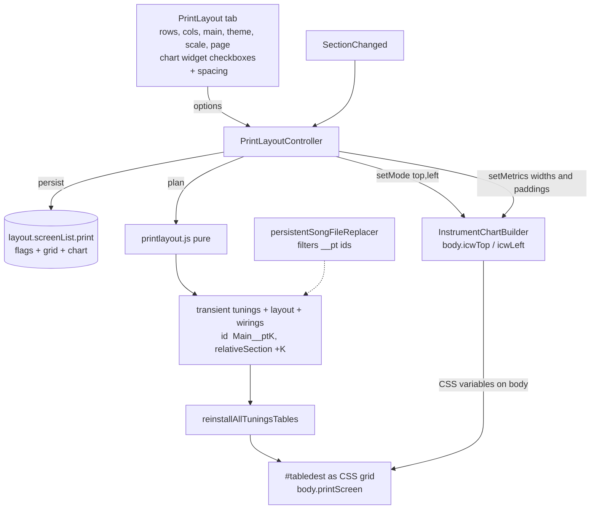

# sprint-154 Iteration 3: implementation plan, revised for the accepted sprint-153

Design: [154-design.md](154-design.md) (Iterations 1 and 2; **there is no Iteration 3 section yet**, so the input for this revision is the 153 design's "Iteration 4 Test Results" plus [153-it3-implementation-plan.md](../153-instrument-chart-widgets/153-it3-implementation-plan.md) section 9)  
Sprint: [sprint-154.md](sprint-154.md)  
Replaces (kept in place for the record): [154-it2-implementation-plan.md](154-it2-implementation-plan.md)  
Depends on: sprint-153, **passed and accepted** ([sprint-153.md](../153-instrument-chart-widgets/sprint-153.md))

Status: **plan only, no code written.**  Files marked **CORE** need `CORE-APPROVED` ([sprints.md](../../../lifecycle/sprints.md)).

**How to read this document.**  Sections 1-3 say what changed since Iteration 2.  Section 4 is the design; parts that did not change are listed in 4.1 with a pointer to the Iteration 2 section that still describes them, and are not restated.  Sections 5-12 are the steps, tests, acceptance, files, questions, holes, and iteration breakdown, all current.

---

## 1. What sprint-153 delivered (verified in the code)

| # | Fact | Where |
|---|---|---|
| A1 | Every **non-Tool** table gets two hosts: `div.instrumentChartTop` (a sibling **before** `.captionRow`, in `.instrumentBackground`) and `div.leftRailChartHost` (a sibling **after** `.leftRailStack`, in `td.tdLeftRailStack`).  Tiles built by `installAllTuningsTables()` get them for free | [TableBuilder.js](../../../../TableBuilder.js#L222) |
| A2 | Visibility is CSS only, from two `<body>` classes `icwTop` / `icwLeft`.  When on, the whole `.captionRow` / `.leftRailStack` is hidden with `display: none !important`; hosts are `display: none` otherwise | [instrument-chart.css](../../../../templates/InstrumentChart/instrument-chart.css) |
| A3 | One global mode `{ top, left }`: `InstrumentChartBuilder.setMode(partial)` (merges booleans), `getMode()`.  Not persisted.  **Reset to off at every Song load** (`updateAfterOpenSong()`) | [instrument-chart.builder.js](../../../../templates/InstrumentChart/instrument-chart.builder.js) |
| A4 | A widget learns its Section from `Widget:SectionStatus:statusChanged` (`ownerID` = table id, `sectionNumber` 1-based, sent by `replayTable()`); per-beat events carry none and are ignored.  So a RELATIVE Observer (a tile) shows its own Section | builder |
| A5 | `reinstallAllTuningsTables()` removes the widgets and the SectionStatus owners whose ids start with `tbl` before rebuilding (the `leadsheet` owner is kept).  **The leak (it2 F11) is fixed** | [infinite-neck.js](../../../../infinite-neck.js) |
| A6 | Templates are a flat `{ top, left }` in `templates/InstrumentChart/instrument-chart-templates.js`; nothing is editable in the UI, nothing persists, no ChartWidgets tab, no `T` / `L` buttons | 153 design, Iterations 3-4 |
| A7 | `${...}` expansion takes a `context`; section-scoped tokens follow the widget's Section; Tonal tokens are scoped too | [approved-values.js](../../../../approved-values.js) |
| A8 | Left host CSS now has `min-width: 4em` (the user's workaround: without it the 153 `min-width: 0` plus wrapping made every chord wrap) | instrument-chart.css |

### The 153 test results, as requirements for this sprint

The panel must offer controls for three things the user tuned by hand in CSS:

1. **Left widget width.**  Not-wrapping is not enough; all tiles must have the **same** rail width, so the layouts tile consistently.
2. **Left widget top padding**, so the vertical widget is spaced down and does not crowd the top (horizontal) widget.
3. **Top widget left padding**, so its text lines up with the left edge of the actual Instrument.  "Presumably setting this left padding to the min-width of the left rail does this."

### A latent bug found while reading (not reported in the 153 test)

[layout.js](../../../../layout.js#L102) `toggleInstrumentCaptions()` and `toggleLeftRails()` store `this.screen.X = $(...).toggle(visible).css('display') !== 'none'`.  `.css('display')` is the **computed** value, so while `icwTop` / `icwLeft` is on (the `!important` rule) they record `false`.  Any `doToggles()` with a widget on (entering or leaving fullscreen, or clicking the Layout toggle) writes a wrong flag into `Layout`, which **is persisted in the Song file**.  It is harmless today because only the console turns the mode on; the panel in this sprint would make it routine.  Fix in Step 3 (read the inline style), and enter / leave print in the order given in 4.4.

---

## 2. What changes in the Iteration 2 plan

| Iteration 2 item | Now |
|---|---|
| `T` / `L` buttons in the hamburger, copied to tiles; "Re-sync widgets from Main" | **Dropped.**  The mode is global (A3), so every tile follows with no copying |
| Tab "ChartWidgets" (editable markup) | **Dropped** (153 design, Iteration 3) |
| Panel persists `ChartWidgetsTop` / `ChartWidgetsLeft` screen flags | **Dropped.**  The panel has two checkboxes, `show top chart widget` and `show left chart widget`, persisted in the panel options (4.7) and applied with `setMode()` |
| `print` screen flags `InstrumentCaptions: false`, `LeftRails: true` ("holds the widget") | `LeftRails` is now **false** and `InstrumentCaptions` **false**.  The widget hosts are not under the Layout flags, so the checkboxes are the only controls; with both unchecked, print shows bare Instruments |
| Re-verify list after 153 | Done: section 1 (A1-A8).  Two items stay as checks (Step 0): the first `statusChanged` of a freshly built tile, and the rail alignment |
| `showDesktopTab` "table-driven in 153 Step 6" | 153 did not do it.  **154 owns it** (Step 7); the new tab is the only one added |
| 153 teardown (it2 F11, H4) | Already done (A5) |
| Panel controls | + widget spacing controls (4.8) |
| Iteration numbers | This plan is Iteration 3; the spike is Iteration 4 (section 12) |

---

## 3. Decisions carried in (unchanged)

| Topic | Decision |
|---|---|
| Layout vs Print Preview | Layout `print` **is** the preview: live (follows the Transport), a real mode, with temporary Observers in temporary tiles that mimic the Main |
| Float, Tool tables, Listeners | Not supported / out of scope.  Everything docked.  One Main Instrument |
| Tiling | CSS Grid, direction **forward only**, blank policy **`blank` only** (the plan hides the tile) |
| Observer management | The system clones the Observers to match the Main; one panel changes all at once and throws them away.  Regenerate yes, undo no |
| Persistence | Only the panel's choices.  Nothing about the tiles goes into the Song file.  Stage B (print every page without navigating) is a later sprint |
| Paging | Transport slides; the panel's Next / Previous move by `rows*cols` |
| DisplayOptions, Theme | Every tile uses the Main's DisplayOptions.  One Theme: Song's, or one chosen in the panel, default `Print` (descends from `Snow`).  `allowThemeAutomation` and Section / table Themes are ignored in `print` |
| Colors | Stylesheet / AutoColor printing is the author's job; a Stylesheet or Look stays selectable in `print` |
| SectionStatus, Caption row | The User turns them off on the Main; no special control.  (Now: the widget checkboxes replace them wholesale in print) |
| Scale | A single `--print-scale` variable |
| Chart | The existing Chart / LeadSheet / Line / "Show Next Line" choices apply |
| Headers / footers | None |
| Commands | Deferred, **except** show / hide / toggle siblings for Layout elements |

---

## 4. Design

### 4.1 Unchanged parts: where they are described

These are in [154-it2-implementation-plan.md](154-it2-implementation-plan.md) and stand as written, apart from the corrections in section 2:

| Part | it2 section | One-line summary |
|---|---|---|
| Points C1-C3 | 2 | Main's DisplayOptions; `print` is usable without fullscreen; options persist in `layout.screenList.print` |
| Verified facts F1-F16 | 3 | F11 is now resolved (A5); F13 is now 154's job |
| Option T: transient tiles | 4.1 | `myTunings` / `noteTablesLayout` / `Wiring` entries with ids `<main>__pt<k>`, `relativeSection: "+k"`; **filtered at save** in `persistentSongFileReplacer`; removed on leave |
| Plan and hiding | 4.2 | Slot `k` shows `cur + k`, or is `null` past the end and is hidden with `visibility: hidden` |
| Which table is the Main | 4.5 | Visible, non-Tool, no wiring; `grid.mainTableID`; the others hidden while in print |
| Navigation | 4.6 | Pages aligned to multiples of N; Next / Previous / First / Last; all through `Song.gotoSection()` |
| Theme `Print` | 4.9 | New built-in from `Snow`; apply through the select, save and restore `song.theme`, guard the automation line |
| Spike recipe | 5 | DevTools snippet; see the addendum in section 5 of this document |

### 4.2 Diagram



### 4.3 Tiles get the widgets for free

Tiles are built by `installAllTuningsTables()` -> `TableBuilder.js`, so each has both hosts and subscribes to `statusChanged` with its own table id (A1, A4).  Nothing in 154 builds, copies, or syncs a widget.  The controller only:

- calls `InstrumentChartBuilder.setMode({ top, left })` from the panel's two checkboxes: on **enter**, on **change**, and with `{ top: false, left: false }` on **leave**;
- after `ensureTiles()` / `removeTiles()` (which end in `reinstallAllTuningsTables()`, tearing down and rebuilding the widgets), relies on the replay at the end of the rebuild to deliver each new tile's first `statusChanged`.  **Step 0 verifies this** (H1).  Fallback if not: the controller triggers one replay after the rebuild.

Blank tiles (past the last Section) are `visibility: hidden`, so a wrapped Section shown by their widget never appears.

### 4.4 Entering and leaving print: order matters

Because of the latent bug in section 1, and because the Layout flags must stay truthful:

`enter()`: 1. record restore state; 2. `layout.enterPrint()` (calls `doToggles()`) **while the widget mode is off**; 3. `ensureTiles()`; 4. then `setMode(...)` and `setMetrics(...)`.

`leave()`: 1. `setMode({ top: false, left: false })` and `resetMetrics()` **first**; 2. `removeTiles()`; 3. `layout.leavePrint()` (calls `doToggles()`).

Step 3 additionally makes `layout.js` read the inline style, so the order is a belt and braces and not the only protection.

### 4.5 The `print` screen flags (replaces it2 4.3 table)

| Flag | `print` default | Why |
|---|---|---|
| `CaptionRow` (title block) | `true` | page title |
| `Caption` (Section caption line) | `false` | the widgets carry it (`${getSectionCaption}` in the Top template) |
| `SongTitle` | `true` | |
| `SongWidgets` | `true` | author's choice |
| `WidgetRow` | `false` | the tiles carry chord and mode |
| `PracticeList` | `false` | |
| `InstrumentCaptions` | `false` | ink-heavy, redundant; replaced by the Top widget when `T` is on |
| `LeftRails` | **`false`** | replaced by the Left widget when `L` is on (hosts are not under this flag) |
| `CaptionLooperLayout` | `column` | irrelevant while the rail is hidden |

The rest of it2 4.3 (`printActive`, `enterPrint` / `leavePrint`, a saved `screen.name === 'print'` reset to `escaped` at load, print is not fullscreen, the Chart host predicate) is unchanged.

### 4.6 Chart widget spacing (new): `InstrumentChartBuilder.setMetrics`

Three user-tuned numbers live in the **153 module**, which owns its CSS; the panel only calls it.  This keeps the CSS in one place, and makes the values usable from the console (`InstrumentChartBuilder.setMetrics({ leftWidthEm: 5 })`), like `setMode`.

| Metric | CSS variable (on `<body>`) | Used by | Default | Range |
|---|---|---|---|---|
| `leftWidthEm` | `--icw-left-width` | `.leftRailChartHost`: `width`, `min-width`, `max-width`, with `box-sizing: border-box` | `4.8` (= today's 4em + 2 x 0.4em padding, so the accepted look is unchanged) | 2 - 12 |
| `leftPaddingTopEm` | `--icw-left-padding-top` | `.leftRailChartHost` padding-top | `0.15` | 0 - 10 |
| `topPaddingLeftEm` | `--icw-top-padding-left` | `.instrumentChartTop` padding-left | `'align'` | `'align'` or 0 - 20 |

- **`'align'`** resolves to `leftWidthEm`.  With `box-sizing: border-box` the left host is exactly `leftWidthEm` wide, so a top padding of the same value puts the top text over the first fret-table column (the user's "presumably").  Verified in Step 0 against the real `.tdLeftRailStack`, which may add padding of its own; if it does, `'align'` adds that constant.
- The left width is **fixed** (`width` = `min-width` = `max-width`), not a bare `min-width`: with a bare `min-width` a tile whose chord is longer (`F#m7b5`) makes its td, and so its rail, wider than the others, which is the inconsistency the user wants to remove.  (Q1.)
- Units are `em` of the host.  The Instrument is scaled with `zoom` (`--print-scale`), which scales every length uniformly, so the three values stay proportional to each other in all tiles.  Both hosts inherit the same font size.
- Pure part (Jest): `normalizeChartWidgetMetrics(raw, current)` in `instrument-chart-core.js` (merge, numbers only, clamp, `'align'` allowed for the top padding) and `resolveChartWidgetMetricVars(metrics)` returning `{ '--icw-left-width': '4.8em', ... }` with `'align'` resolved.  DOM part: `InstrumentChartBuilder.setMetrics(raw)` (merge, set the variables on `document.body`), `getMetrics()`, `resetMetrics()` (remove the variables so the CSS fallbacks apply).  The CSS reads `var(--icw-left-width, 4.8em)` etc., so with no variable set the output is exactly the accepted look.
- `resetMetrics()` is also called with `setMode` reset in `updateAfterOpenSong()` (one more line in CORE `infinite-neck.js`), so a Song load never inherits metrics.

### 4.7 Panel (Tab "PrintLayout") and persistence

Controls, top to bottom:

1. `Enter Print Layout` / `Exit Print Layout`, one-line status.
2. **Main Instrument** select.
3. **Rows**, **Columns** (1-8 each, `rows*cols <= 24`).  "N Sections per page, K tiles".
4. **Theme**: `Print` (default), `Song's Theme (no change)`, then the built-ins.
5. **Scale**: `Auto fit` or a percent.
6. **Page**: `|<  <  Page p of q  >  >|` with the Sections range.
7. **Chart widgets** (new):
   - `[x] show top chart widget`, `[x] show left chart widget`.
   - **Left widget width** (em), **Left widget top padding** (em).
   - **Top widget left padding** (em) and `[x] Align with left rail` (checked = `'align'`; the number field is disabled).
   - The spacing fields are disabled while their widget is unchecked.
8. `Print...` (`window.print()`).
9. A hint: choose the Chart variant with the usual commands.

Every control calls `PrintLayoutController.apply()`.  Rows / columns / Main rebuild tiles; the checkboxes and spacing fields touch only `setMode` / `setMetrics` (CSS variables: no rebuild, no debounce needed); Theme / Scale touch CSS.

```json
"layout": { "screenList": { "print": {
  "name": "print", "CaptionRow": true, "Caption": false, "SongTitle": true, "SongWidgets": true,
  "PracticeList": false, "WidgetRow": false, "InstrumentCaptions": false, "LeftRails": false,
  "CaptionLooperLayout": "column",
  "grid":  { "rows": 2, "cols": 3, "mainTableID": "tblP46_1", "theme": "Print", "scale": "auto" },
  "chart": { "top": true, "left": true, "leftWidthEm": 4.8, "leftPaddingTopEm": 0.15, "topPaddingLeftEm": "align" }
}}}
```

Ten values.  A missing `print`, `grid`, or `chart` is back-filled in the `Layout` constructor (it must be: `Object.assign(this, jsonObj)` replaces the whole `screenList`, so a Song saved before this sprint has no `print`).  Normalization is pure (`normalizePrintOptions` in `printlayout.js`, which delegates the `chart` part to `normalizeChartWidgetMetrics`).  Default for both checkboxes is `true`, since the widgets are the point of the preview.

### 4.8 CSS

`print.css` is as in it2 4.10 (grid, `printExcluded`, `printBlank`, `--print-scale` via `zoom`, `@page`, `@media print` hides `.container`).  One change in the 153 file, [instrument-chart.css](../../../../templates/InstrumentChart/instrument-chart.css):

```css
body.icwTop .instrumentChartTop  { padding-left: var(--icw-top-padding-left, 0.4em); }
body.icwLeft .leftRailChartHost  {
    box-sizing: border-box;
    width: var(--icw-left-width, 4.8em);
    min-width: var(--icw-left-width, 4.8em);
    max-width: var(--icw-left-width, 4.8em);
    padding: var(--icw-left-padding-top, 0.15em) 0.4em 0.15em;
}
```

(Merged into the existing rules; the user's current file may have changed since it was written, so Step 5 starts by reading it.)

---

## 5. Spike addendum (the recipe is in it2 section 5, still valid)

Two corrections to use it with the sprint-153 build:

1. Turn the widgets on first (`InstrumentChartBuilder.setMode({ top: true, left: true })`) so the spike measures what will print.  The snippet's `.captionRow` hide rule is then redundant but harmless.
2. `spike.measure()` reads `.fretTableWrapper > table`, which **excludes the left rail** although its comment says otherwise.  Measure the whole Instrument instead, or the fit comes out too big by the rail width: change the width source to `o.querySelector('.instrumentBackground').scrollWidth`.

Extra rows for the table in 5.3, now that the widgets exist:

| Try | How |
|---|---|
| Rail consistency | with `L` on, `spike.apply({cols: 3})`, then in the console compare `document.querySelectorAll('.leftRailChartHost')` widths (`getBoundingClientRect().width`): all equal? Then set `document.body.style.setProperty('--icw-left-width','3em')` to see the narrowest that does not wrap the longest chord |
| Top alignment | `document.querySelector('.instrumentChartTop').style.paddingLeft` set to the rail's width: does the text start over the first fret column? Record the difference if the `td` adds padding (4.6) |
| Rebuild fills tiles (H1) | change rows / columns with widgets on (once the panel exists) or `reinstallAllTuningsTables()` from the console: do all widgets fill, without a Transport move? |

Add the results to this document (or `154-spike-results.md`) before the implementation round.

---

## 6. Implementation steps

### Step 0. Spike and read-only checks (no code)

Section 5 plus the Iteration 2 Step 0 list (rebuild cost with 6 and 12 tables; every reader of `myTunings` / `noteTablesLayout` / `wirings` that could mis-handle a `__pt` id; `sectionNotesByTable` tile keys; the Theme-change path to `Song.theme`) plus:

- the first `statusChanged` of a freshly built tile (H1);
- the rail alignment and the `'align'` constant (4.6);
- that `Layout.doToggles()` really writes the wrong flag while a widget is on (reproduce the latent bug, section 1).

### Step 1. Pure module `printlayout.js` (new, no DOM, no jQuery)

As it2 Step 1 (`normalizePrintOptions`, `isPrintTileID`, `tileBaseID`, `tileCount`, `planTiles`, `sectionIndexForSlot`, `hiddenSlots`, `pageInfo`, next / previous / first / last, `fitScale`), with `normalizePrintOptions` also normalizing `chart` (checkboxes default `true`, metrics through `normalizeChartWidgetMetrics`).

### Step 2. Persistence filter, **CORE:** [SongPersistence.js](../../../../SongPersistence.js)

As it2 Step 2: `persistentSongFileReplacer` drops entries whose id matches `isPrintTileID` from `myTunings`, `wirings`, `noteTablesLayout`, and `sectionNotesByTable` keys.

### Step 3. Layout, [layout.js](../../../../layout.js) (not CORE)

- `screenList.print` defaults (4.5, 4.7); back-fill `print`, `grid`, `chart` for older Songs; reset a persisted `screen.name === 'print'` to `escaped`.
- `printActive`, `enterPrint()`, `leavePrint()`, `isPrint()`; `enterFullscreen()` / `leaveFullscreen()` honor it.
- **Fix the latent bug**: `toggleInstrumentCaptions()` and `toggleLeftRails()` read the inline `style.display` of the elements they toggled (with an "any element exists" guard) instead of the computed `display`.  Other `toggle*` methods target elements no widget rule hides, so they are unchanged.
- Jest in [layout.test.js](../../../../_tests/jest/layout.test.js) for the pure parts (defaults, back-fill, no auto-resume, round trip).  The jQuery read fix is checked in the UI script (item 12), per the repo rule that Jest avoids jQuery.

### Step 4. Theme `Print`, [themes.js](../../../../themes.js)

As it2 Step 4: values from the spike.  Check whether any Theme test or the Theme Matrix assumes a fixed list.

### Step 5. Widget metrics in the 153 module, then CSS

- [instrument-chart-core.js](../../../../templates/InstrumentChart/instrument-chart-core.js): `normalizeChartWidgetMetrics`, `resolveChartWidgetMetricVars`, `CHART_WIDGET_METRIC_DEFAULTS`.
- [instrument-chart.builder.js](../../../../templates/InstrumentChart/instrument-chart.builder.js): `setMetrics`, `getMetrics`, `resetMetrics` (4.6).
- [instrument-chart.css](../../../../templates/InstrumentChart/instrument-chart.css): 4.8 (read the current file first).
- `print.css` (new) from it2 4.10, and `<link>` in [index.html](../../../../index.html) after instrument.css.
- Jest: section 7.

### Step 6. Controller and panel, `templates/printlayout/printlayout.html|.builder.js|.css` (new)

- `PrintLayoutController`: `enter`, `leave`, `apply`, `isActive`, `ensureTiles`, `removeTiles`, `markBlankTiles`, `applyScale`, `applyChartWidgets` (calls `setMode` / `setMetrics`), `nextPage`, `previousPage`, `firstPage`, `lastPage`, `print`.  Uses `Song` public methods only.  No "sync widgets" function exists.
- Panel per 4.7.  Subscribes to `SectionChanged`.  Providers injected from `infinite-neck.js`, as the other builders.
- The enter / leave order in 4.4.

### Step 7. Wiring, **CORE:** [infinite-neck.js](../../../../infinite-neck.js), [index.html](../../../../index.html)

- **Table-driven `showDesktopTab`** (it is still an if-chain over `Buttons`, `SongWidgets`, `MIDI`, with the keyboard tab as the default): one row per tab `{ which, button, panel, onLeave }`, then add `PrintLayout`.  Keep the `SongWidgetsBuilder.persistSongWidgets()` call as the SongWidgets `onLeave`.
- Tab button `#btnDesktopTabPrintLayout` and panel `#divPrintLayoutTab`; builder `addToDest` and `renderFromSong` on load.
- One `isFullscreenChartAllowed()` = `isFullscreenActive() || isStrictTutorial() || isPrintLayoutActive()`, replacing the 8 `isFullscreenActive() || isStrictTutorial()` sites (`updateFullscreen*Host`, `hideFullscreen*`, and the two checks near L3153 / L3164; grep to be exact).
- `updateAfterOpenSong()`: `PrintLayoutController.leave()` (silently) before the new Song builds, and `InstrumentChartBuilder.resetMetrics()` next to the existing `setMode({ top: false, left: false })`.
- Theme: the guard on the `allowThemeAutomation` branch in `displayOptionsToControls()` and the restore in `updateMemoryModelPreFileSave()`.

### Step 8. Commands (deferred except siblings)

Only show / hide / toggle siblings for entering and leaving the print Layout; letter decided in review (Q6).  No command for the widget checkboxes or metrics in this sprint (the console API already exists).

### Step 9. Docs

[help.html](../../../../help.html): "Printing and Superchart" (panel, pages, widgets and spacing, Chart variants, the print dialog settings that matter: Background graphics, margins, scale 100 percent), the Print Theme.  Update [sprint-154.md](sprint-154.md).

---

## 7. Tests (Jest, non-browser)

| File | Covers |
|---|---|
| `_tests/jest/printlayout.test.js` (new) | as it2 section 7, plus `normalizePrintOptions` `chart` defaults and clamping, and that unknown / non-boolean `top` / `left` fall back to `true` |
| `_tests/jest/instrument-chart-core.test.js` (extend) | `normalizeChartWidgetMetrics`: merge, clamp to the ranges, non-numbers ignored, `'align'` accepted only for `topPaddingLeftEm`; `resolveChartWidgetMetricVars`: `'align'` resolves to `leftWidthEm`; defaults produce the accepted CSS fallbacks (4.8em / 0.15em / 0.4em); a guard that every variable name used in `instrument-chart.css` is one the core produces |
| `_tests/jest/instrument-chart-builder.test.js` (extend) | `setMetrics` merges, sets variables on a fake `document.body.style`, `resetMetrics` removes them; `getMetrics` returns a copy |
| persistence test (extend) | tile entries never saved; no tile keys in `sectionNotesByTable`; a normal Song is byte-identical |
| [layout.test.js](../../../../_tests/jest/layout.test.js) (extend) | Step 3 pure parts, including that an older Layout without `print` back-fills it with the 4.5 flags |
| themes test (if one exists) | `Print` present, based on `Snow` keys |

---

## 8. UI acceptance script

Items 1-11 are from Iteration 2, updated; 12-15 are new.

1. One Instrument, six or more Sections.  Rows 2, Columns 3, Enter.  Five tiles in a 2 x 3 grid, Main top-left; tiles show Sections `cur .. cur+5` and follow the Transport.
2. Section 5 of 8: tiles past Section 8 are blank, grid shape unchanged.
3. Change Rows or Columns: tiles regenerate live.  Change the Main (two Instruments): tiles regenerate; the other Instrument is hidden.
4. Page buttons per 4.6; the label is right while sliding.
5. Check `show top chart widget` and `show left chart widget`: **every** tile, including newly built ones, shows its **own** Section's chord, mode, keys, number; uncheck: the tiles show bare Instruments (print flags hide the rail and caption row); the Instrument Caption Row and left rail do not come back in print.
6. Theme: `Print` default; switch to `Song's Theme`; leave: the Song's Theme is back.  Save while in print and reopen: no tiles, original theme.
7. Chart / LeadSheet / Line commands show above the grid and print.
8. Ctrl+P: preview matches the screen (menus gone), tiles do not split, colors present with Background graphics on.
9. Fullscreen while in print: Layout stays `print`; ESC returns to the panel.
10. Open another Song while in print: print ends cleanly, no widget errors, registries empty (`InstrumentChartBuilder.registry.size` equals the new Song's table count; the mode and metrics are reset).
11. Floated Main: entering print docks it; leaving does not re-float.
12. **Layout flags stay truthful.**  With widgets on, toggle fullscreen on and off and use the Layout toggles; save; reopen: `InstrumentCaptions` and `LeftRails` are what they were before, not `false`.
13. **Left width.**  With the chords of the sample Song, set Left widget width to 4.8: no chord wraps and every tile's rail is the same width (measure); set a longer chord in one Section: still the same width in all tiles.  Lower it until a chord wraps, then restore.
14. **Top alignment.**  `Align with left rail` checked: the Top text starts over the first fret column in every tile; changing the left width moves the Top text with it; unchecked: the number field controls it.
15. **Vertical spacing.**  Raising Left widget top padding moves the vertical widget down without moving the Top widget or the fret table, identically in all tiles; all three values survive Exit, Enter, and a save / reopen.

---

## 9. Files touched

| File | Change | CORE? |
|---|---|---|
| `printlayout.js` | new, pure | no |
| `templates/printlayout/*` | new panel, controller | no |
| `print.css` | new | no |
| `templates/InstrumentChart/instrument-chart-core.js`, `instrument-chart.builder.js`, `instrument-chart.css` | metrics (4.6, 4.8) | no |
| `layout.js` | `print` screen, `printActive`, inline-read fix | no |
| `themes.js` | `Print` Theme | no |
| `index.html`, `help.html` | tab, links, docs | no |
| **`SongPersistence.js`** | replacer filter | **CORE** |
| **`infinite-neck.js`** | table-driven tabs, panel wiring, Chart-host predicate, theme guard / restore, load hook, `resetMetrics` | **CORE** |
| `TableBuilder.js`, `Song.js`, `NoteTableController.js`, `Wiring.js` | **not touched** | |

---

## 10. Questions for the review round

Carried from Iteration 2 (not yet answered), each with a recommendation:

- **Q2. `print` flag defaults** (4.5), now including `LeftRails: false`.  Recommended as written.
- **Q3. The panel in fullscreen print.**  Recommended: ESC returns to it; floating it via `dockable.js` later if wanted.
- **Q4. Print is not fullscreen** (menus stay, `@media print` hides them).  Recommended: yes.
- **Q5. Option T** (transient tiles in the model, filtered at save).  Recommended: yes.
- **Q6. Command siblings.**  Which letter, and an enter / leave pair now?
- **Q7. Main's own per-table Theme override** while previewing: recommended ignore and restore on leave.
- **Q8. Pages aligned to multiples of N** (Next snaps).  Recommended: yes.
- **Q9. Size caps:** 1-8 for rows and columns, 24 tiles.  Enough?
- **Q10. Auto fit in the first round**, or manual percent until the spike results are in?  Recommended: both, Auto fit measured from `.instrumentBackground`.
- **Q11. Which table is the Main** when several qualify: remember only in the panel (recommended).

New:

- **Q1. Left width: fixed or minimum?**  Recommended **fixed** (`width` = `min-width` = `max-width`) so all tiles match even with a longer chord.  If you prefer the pure `min-width` of your workaround, the CSS drops two lines and the label says "minimum".
- **Q12. Default width** `4.8em` (identical to your accepted look, 4em plus padding) or a round `4em` total?
- **Q13. Top padding default `'align'`** (checked) when the left widget is on.  When the left widget is off, the Top widget has nothing to align with, so the number field is used (default `0.4em`).  OK?
- **Q14. Widget checkbox defaults** `true` / `true` in `print`.  OK?
- **Q15. The latent Layout bug fix** (Step 3) is outside the print work.  Include it in this sprint (recommended; two lines in a non-CORE file), or log it separately?
- **Q16. `showDesktopTab` refactor** in `infinite-neck.js` is CORE and touches working tabs.  Recommended: do it (adds the tab cleanly, covered by the UI script); alternative: one more `if` branch with no refactor.

---

## 11. Holes

| # | Hole | Proposed handling |
|---|---|---|
| H1 | A freshly built tile's widget knows no Section until its first `statusChanged` | Step 0 verifies the rebuild replay delivers it; fallback: the controller triggers one replay |
| H2 | Rebuilding every table on each rows / cols / Main change may feel slow | Step 0 measures; if slow, extract `installOneTuningTable` (CORE), or debounce 200 ms |
| H3 | `zoom` vs `transform`; the fit formula | decided by the spike; the fit now uses the whole Instrument width |
| H4 | The Main's hamburger toggles are local DOM state that a rebuild resets | acceptable; flags come back from the model |
| H5 | Transient tables appear in model-reading lists during print | Step 0 audit; names carry `__pt` |
| H6 | Rail width and `'align'` may differ by the `td`'s own padding | Step 0 measures; `'align'` adds a constant if needed |
| H7 | `em` values depend on the host font size; if the two hosts later get different font sizes the alignment drifts | both inherit today; if that changes, switch to `rem` or `px` before `zoom` |
| H8 | A long chord could still overflow the fixed rail width | `overflow-wrap: anywhere` wraps it; the User raises the width (that is why the control exists) |
| H9 | Metrics are global (body variables), so a later per-Instrument tweak is impossible | accepted: consistency across tiles is the requirement |
| H10 | Layout flags corrupted by computed-display reads | Step 3 fix, the enter / leave order (4.4), acceptance item 12 |
| H11 | A Song with one Section: 1 x 1 or all-blank tiles | allowed |
| H12 | Page background and dark Themes in `@media print` | white page when the Theme is light; a dark Theme prints dark (author's choice) |
| H13 | Printed Chart width | the Chart host is a block above the grid, so it prints at page width; check in the spike |
| H14 | While the Top widget replaces the caption row its buttons (Float, Tuning, Tonal, wiring) are unreachable | accepted, print only; unchecking restores them |

---

## 12. Suggested iteration breakdown

1. **Iteration 4 (spike):** Step 0 and section 5, results appended to this document or `154-spike-results.md`.  No code.
2. **Iteration 5:** Steps 1, 2, 3, 4, 5 (pure module, persistence filter, Layout including the bug fix, Theme draft, metrics in the 153 module) with Jest.  CORE: `SongPersistence.js`.
3. **Iteration 6:** Steps 6, 7 (CSS, controller, panel, wiring) and acceptance items 1-5, 9-12.  CORE: `infinite-neck.js`.
4. **Iteration 7:** Theme tuning from the spike, Chart in print, scale, acceptance items 6-8 and 13-15; Step 8 siblings; Step 9 docs.
5. **Later sprint:** Stage B (print every page without navigating), the template selector (named choices in `instrument-chart-templates.js`), per-Section display options, headers / footers.
